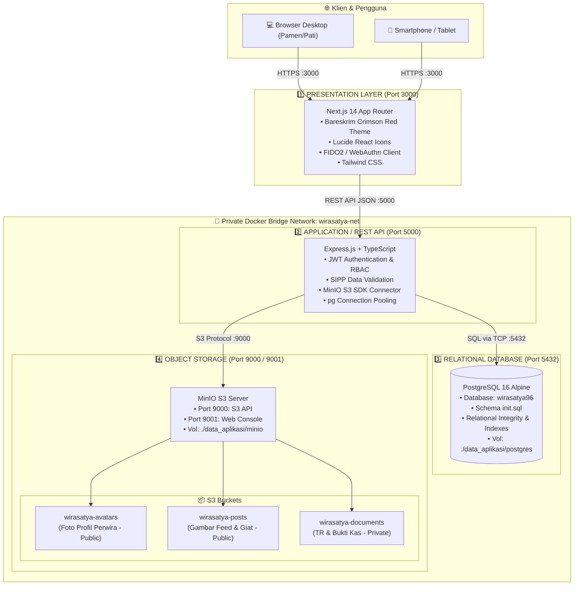
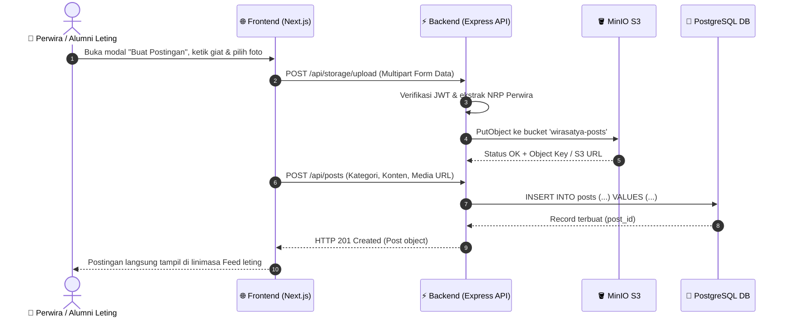
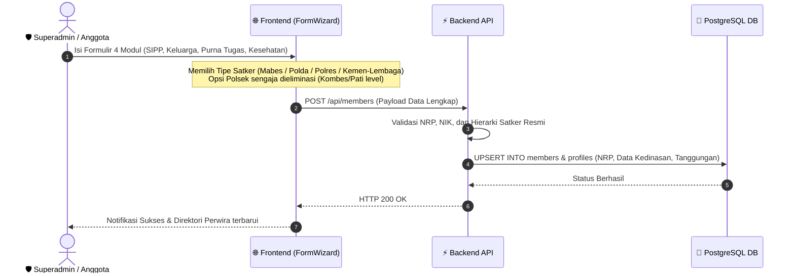
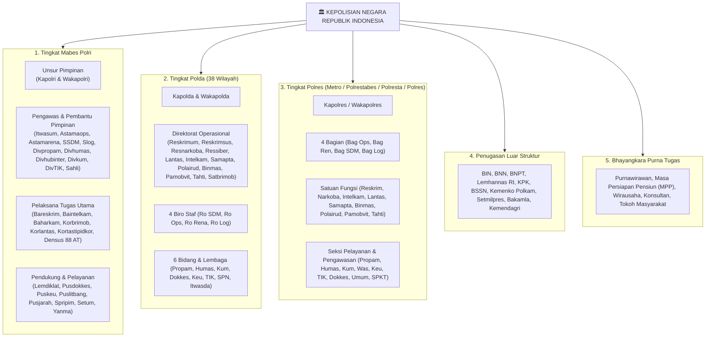

# 🏛️ ARSITEKTUR SISTEM WIRA SATYA 96
**Spesifikasi Arsitektur 4-Tier Decoupled & Topologi Kontainer Platform Batalyon Wira Satya Akpol 1996 (#SelaluBahagia)**

---

## 1. Ringkasan Eksekutif (Executive Summary)

Platform **Sistem Informasi Batalyon Wira Satya Akpol 1996** dirancang dengan arsitektur modern berstandar enterprise yang mengusung prinsip **4-Tier Decoupled Architecture**. Setiap komponen (Frontend, Backend API, Database Relasional, dan Object Storage S3) beroperasi secara independen dalam kontainer Docker terisolasi dan berkomunikasi melalui protokol standar industri (HTTP/REST, TCP/PostgreSQL, dan S3 API).

Pemisahan ini menjamin:
- **Skalabilitas Horizontal**: Frontend dan Backend dapat di-scale secara mandiri.
- **Isolasi Keamanan**: Database dan penyimpanan dokumen tidak terpapar langsung ke jaringan publik.
- **Portabilitas Cloud-Native**: Dapat dijalankan di server lokal (Docker Compose / on-premise) maupun di-deploy ke cloud (Vercel, AWS ECS, Google Cloud Run, atau Kubernetes).

---

## 2. Diagram Konteks Sistem (System Topology)

---

## 3. Rincian Komponen 4-Tier

| Tier | Layanan | Teknologi | Port | Fungsi Utama | Aksesibilitas |
|---|---|---|---|---|---|
| **Tier 1** | **Frontend (FE)** | Next.js 14 App Router, React 18, Tailwind CSS, Lucide | `3000` | Antarmuka interaktif bernuansa Bareskrim Crimson Red, Buku Saku Digital, Feed Silaturahmi multi-reaksi, Riwayat Jabatan Leting, Form SIPP, dan Manajemen Kas. | Publik via Web Browser (`http://localhost:3000`) |
| **Tier 2** | **Backend (BE)** | Node.js, Express, TypeScript, S3 SDK, pg Pool | `5000` | API Gateway RESTful modular (`/api/auth`, `/api/members`, `/api/posts`, `/api/finance`, `/api/storage`), autentikasi JWT, validasi SIPP, dan orkestrasi presigned URL. | Terhubung ke FE via internal/external proxy |
| **Tier 3** | **Database (DB)** | PostgreSQL 16 Alpine | `5432` | Penyimpanan data relasional terstruktur: identitas 286 perwira, riwayat dinas, penempatan 38 Polda/Mabes/Polres, data keluarga, data kas, dan linimasa postingan. | Privat dalam `wirasatya-net` |
| **Tier 4** | **Object Storage** | MinIO S3 Engine | `9000` (API) `9001` (GUI) | Penyimpanan aset biner tak terstruktur (foto profil, dokumentasi giat leting, lampiran PDF Surat Telegram/TR). | S3 API internal & Console admin |

---

## 4. Topologi Jaringan Kontainer & Docker Compose

Seluruh kontainer diorkestrasi menggunakan [docker-compose.yml](file:///d:/Project/KAP%20IDAH/wirasatya96/docker-compose.yml) yang terisolasi dalam satu virtual bridge network: `wirasatya-net`.

### Urutan Booting & Healthchecks (Boot Sequence):
1. **`postgres`** menyala pertama kali dan memvalidasi kesiapan socket database via `pg_isready`. Skema `database/init.sql` otomatis dieksekusi saat inisialisasi volume pertama.
2. **`minio`** menyala secara paralel dan memverifikasi kesiapan endpoint melalui `curl http://localhost:9000/minio/health/live`.
3. **`minio-init`** (kontainer pembantu) berjalan otomatis begitu MinIO *healthy*, mengonfigurasi alias `localminio`, membuat ketiga bucket (`wirasatya-avatars`, `wirasatya-posts`, `wirasatya-documents`), dan menerapkan hak akses download publik/privat.
4. **`backend`** menyala setelah `postgres` dan `minio` dalam status *healthy*, melakukan verifikasi koneksi pool dan memulai listening pada port 5000.
5. **`frontend`** menyala dan terhubung ke backend Express via variabel lingkungan `NEXT_PUBLIC_API_URL`.

### Volume Persistensi Data:
- Database PostgreSQL: `./data_aplikasi/postgres` → `/var/lib/postgresql/data`
- Object Storage MinIO: `./data_aplikasi/minio` → `/data`
- Direktori Cadangan Database: `./data_aplikasi/backups` → `/backups`

---

## 5. Alur Data End-to-End (Data Flow Scenarios)

### Skenario A: Unggah Media & Publikasi Linimasa (Social Feed Flow)

---

### Skenario B: Pendataan SIPP Polri (Form Wizard Flow)

---

## 6. Standar SOTK Polri & Hirarki Satuan Kerja

Aplikasi mengintegrasikan struktur organisasi Polri mutakhir (Perpres No. 52/2010 jo Perpres No. 5/2017, Perpol No. 14/2018, Perpol No. 2/2021, dan pembentukan Korps 2024):

> [!NOTE]
> **Eliminasi Satker Polsek**: Karena seluruh alumni Akpol 1996 (Wira Satya 96) saat ini telah berdinas selama 30 tahun dan berada pada jenjang pangkat **Kombes Pol**, **Brigjen Pol**, **Irjen Pol**, atau Purna Tugas, maka penempatan Polsek (tingkat Pama Ipda/Iptu/AKP) **sengaja ditiadakan** dari antarmuka formulir dan filter untuk efisiensi serta relevansi data kedinasan.

---

## 7. Ketahanan Sistem & Pencadangan (Backup & Disaster Recovery)

- **Automated Database Dumps**: Script utilitas menghasilkan file SQL dump harian ke folder `./data_aplikasi/backups`.
- **MinIO Data Mirroring**: Folder data MinIO dapat disinkronkan secara periodik ke AWS S3 / Google Cloud Storage menggunakan perintah `mc mirror`.
- **Graceful Error Handling**: Jika koneksi backend ke database terputus sementara, frontend Next.js secara cerdas beralih ke cache data lokal tanpa membuat aplikasi *crash*.
