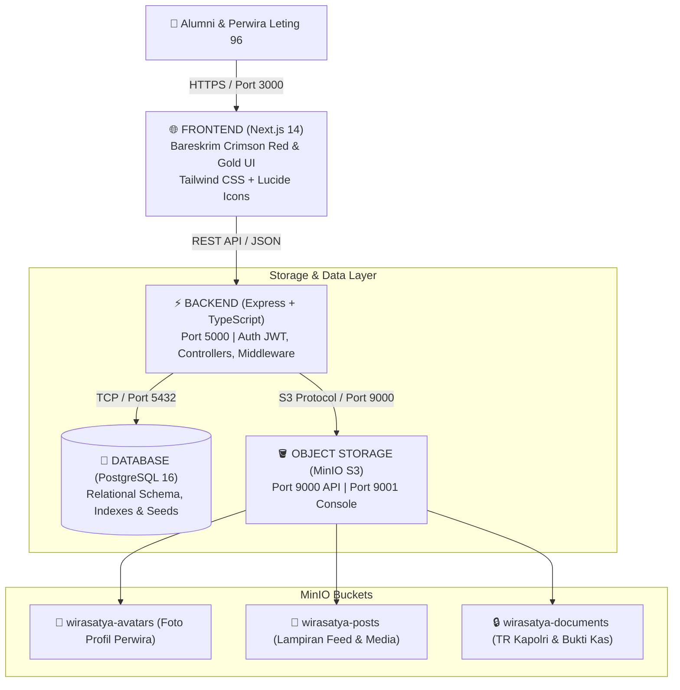

# 🏛️ ARSITEKTUR SISTEM WIRA SATYA 96
**Platform Internal Alumni Batalyon Wira Satya Akpol 1996 (#SelaluBahagia)**

---

## 1. Pemisahan Modular 4-Tier (FE, BE, DB, MinIO)

Sistem telah dipisahkan secara modular menjadi 4 komponen independen sesuai arsitektur microservices enterprise:



---

## 2. Rincian Port & Komponen

| Komponen | Teknologi | Port | Deskripsi | Akses |
|---|---|---|---|---|
| **Frontend (FE)** | Next.js 14 App Router, React, Tailwind CSS | `3000` | Antarmuka pengguna bernuansa Bareskrim Merah Tua (`#8B0000`), Feed Multi-Reaksi, Riwayat Jabatan Leting, Pengaturan & FIDO2 | `http://localhost:3000` |
| **Backend (BE)** | Node.js, Express, TypeScript | `5000` | REST API modular (`/api/auth`, `/api/members`, `/api/jabatan`, `/api/posts`, `/api/finance`, `/api/storage`) | `http://localhost:5000` |
| **Database (DB)** | PostgreSQL 16 Alpine | `5432` | Basis data relasional dengan skema `init.sql`, enkripsi UUID, dan data awal Batalyon Wira Satya 96 | `localhost:5432` |
| **Object Storage (MinIO S3)** | MinIO Server | `9000` | API kompatibel AWS S3 untuk upload avatar, foto giat leting, dan dokumen TR | `http://localhost:9000` |
| **MinIO Console** | MinIO Web GUI | `9001` | Dashboard manajemen bucket, file browsing, dan audit kuota | `http://localhost:9001` (User: `minioadmin`) |

---

## 3. Struktur Direktori Terpisah

```
d:/Project/KAP IDAH/wirasatya96/
├── backend/                       # [BE] Dedicated Express REST API
│   ├── src/
│   │   ├── config/
│   │   │   ├── db.ts              # PostgreSQL Connection Pool
│   │   │   └── minio.ts           # MinIO S3 SDK Configuration
│   │   ├── routes/
│   │   │   ├── auth.ts            # JWT Authentication & Profile Session
│   │   │   ├── members.ts         # Direktori 286 Perwira & Filter Polda
│   │   │   ├── jabatan.ts         # Riwayat Jabatan & Mutasi TR Internal Leting 96
│   │   │   ├── posts.ts           # Linimasa, 6 Multi-Emoji Reaksi & Nested Komentar
│   │   │   ├── finance.ts         # Rekapitulasi Kas & Pencatatan Iuran
│   │   │   ├── kesehatan.ts       # Atensi Rekan & Keluarga Sakit
│   │   │   └── storage.ts         # Upload & Presigned URL MinIO
│   │   └── index.ts               # Express Entrypoint & Healthcheck
│   ├── backend.Dockerfile         # Container definition BE
│   ├── package.json
│   └── tsconfig.json
├── database/                      # [DB] PostgreSQL Schema & Seeds
│   └── init.sql                   # Skema DDL: users, profiles, posts, reactions, kas
├── minio/                         # [MinIO] S3 Buckets & Access Policies
│   ├── init-buckets.sh            # Auto-create bucket & public/private ACLs (Docker)
│   └── setup-buckets.bat          # Script inisialisasi lokal (Windows)
├── src/                           # [FE] Next.js Frontend Application
│   ├── app/                       # App Router & Pages
│   ├── components/                # UI Components (Bareskrim Red Theme, Reactions, Jabatan)
│   ├── data/                      # Client-side Mock & Typings
│   └── types/                     # TypeScript Interfaces
├── frontend.Dockerfile            # Container definition FE
├── docker-compose.yml             # Orchestration untuk 4 layanan sekaligus
└── ARCHITECTURE.md                # Dokumentasi Arsitektur
```

---

## 4. Cara Menjalankan (Deployment Guide)

### Opsi A: Menjalankan Seluruh Sistem dengan Docker Compose (Satu Perintah)
Pastikan Docker Desktop aktif di sistem, lalu jalankan:
```bash
docker-compose up --build -d
```
Sistem akan otomatis:
1. Menginisialisasi PostgreSQL dan menjalankan `database/init.sql`.
2. Menyalakan MinIO dan otomatis mengeksekusi kontainer `minio-init` untuk membuat bucket `wirasatya-avatars`, `wirasatya-posts`, dan `wirasatya-documents`.
3. Membangun dan menjalankan backend Express di port 5000.
4. Membangun dan menjalankan frontend Next.js di port 3000.

### Opsi B: Menjalankan Secara Standalone / Manual
1. **Frontend (Next.js)**:
   ```bash
   cd wirasatya96
   npm run build
   npm run start -- -p 3000
   ```
2. **Backend (Express)**:
   ```bash
   cd wirasatya96/backend
   npm install
   npm run dev
   ```
3. **Database (PostgreSQL)**:
   Jalankan file `database/init.sql` pada PostgreSQL instance lokal Anda.
4. **MinIO**:
   Unduh `minio.exe` dan jalankan:
   ```cmd
   minio.exe server D:\minio-data --console-address ":9001"
   ```
