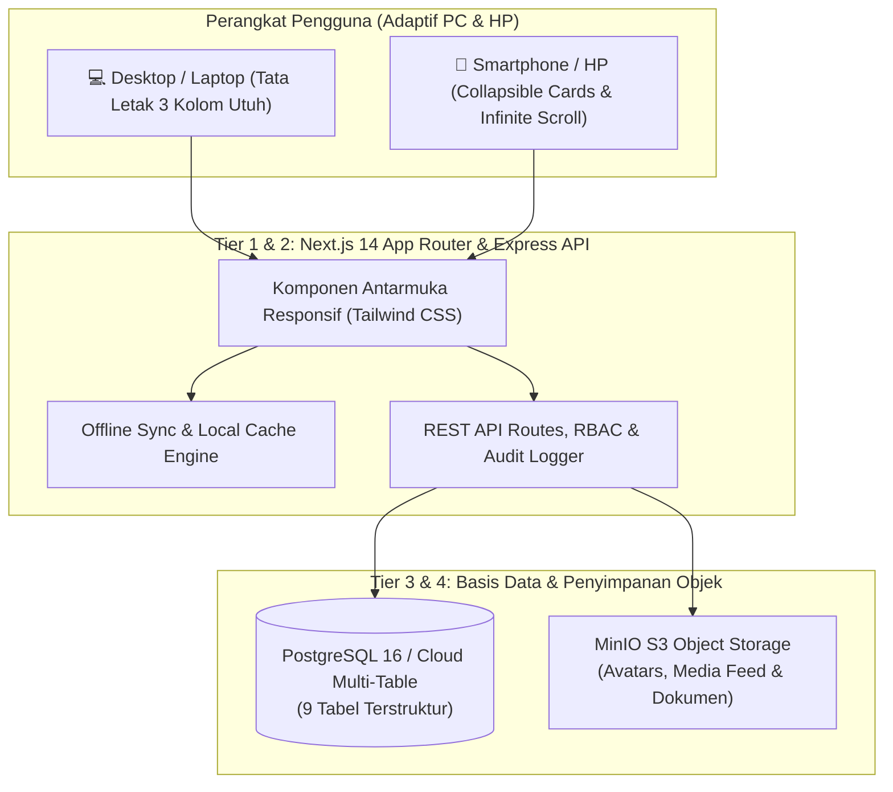
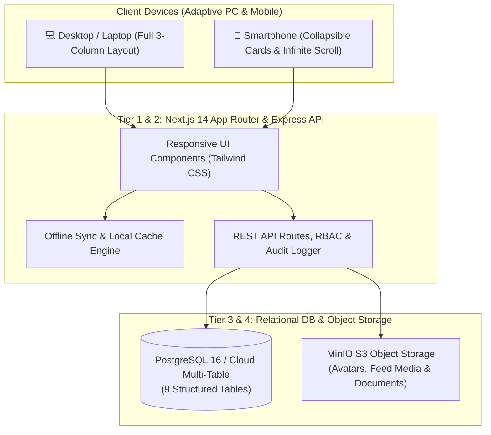

# 🏛️ SPESIFIKASI ARSITEKTUR SISTEM / SYSTEM ARCHITECTURE
### Sistem Informasi Batalyon Wira Satya Akpol 1996

**[🇮🇩 Bahasa Indonesia](#-spesifikasi-arsitektur-bahasa-indonesia)** · **[🇬🇧 English Version](#-architecture-specification-english-version)**

---

# 🇮🇩 Spesifikasi Arsitektur (Bahasa Indonesia)

Sistem Informasi Batalyon Wira Satya Akpol 1996 mengadopsi arsitektur **Multi-Tier Decoupled & Cloud-Synced Architecture** yang memisahkan lapisan antarmuka pengguna, logika bisnis/API, persistensi basis data relasional 9-tabel, serta penyimpanan objek media.

## 1. Topologi Sistem & Aliran Data

## 2. Skema 9 Tabel Terstruktur (Multi-Table Persistence)

Untuk mendukung akses dan pembaruan data serentak (*concurrent multi-user input*) tanpa saling menimpa, basis data dibagi menjadi 9 tabel terpisah:
1. `ws96_members`: Direktori perwira alumni, penempatan SOTK (Mabes/38 Polda/Luar Struktur), riwayat jabatan, keluarga, dan daftar Ajudan (ADC).
2. `ws96_users`: Akun autentikasi, peran RBAC (`SUPERADMIN`, `KETUA`, `SEKRETARIS`, `BENDAHARA`, `ANGGOTA`), dan penanda akun delegasi ADC.
3. `ws96_iuran`: Status kepatuhan iuran wajib tahunan anggota aktif (serta pembebasan otomatis bagi status Purna Tugas, PTDH, dan Almarhum).
4. `ws96_transactions`: Buku besar mutasi pemasukan dan pengeluaran pada **Dana Sosial** dan **Dana Investasi**.
5. `ws96_assets`: Portofolio komponen **Dana Investasi** (deposito, SBN/obligasi, emas/logam mulia, unit usaha, properti).
6. `ws96_posts`: Publikasi kegiatan pada linimasa beranda beserta multi-reaksi dan komentar bersarang.
7. `ws96_messages`: Pesan obrolan langsung antar-perwira.
8. `ws96_audit_logs`: Catatan rekam jejak manajemen pengguna, pemulihan akun, reset kata sandi, dan aktivitas Ajudan (ADC).
9. `ws96_config`: Konfigurasi sistem, parameter iuran, serta daftar kampanye **Penggalangan Dana (*Crowdfunding Milestone*)**.

## 3. Desain Responsif & Ketahanan Offline
- **Pemisahan Tampilan PC vs HP**: Menggunakan *breakpoint* responsif sehingga tampilan Desktop tetap mempertahankan 3 kolom utuh dengan label deskriptif lengkap, sementara tampilan HP menggunakan *header* kartu buka-tutup (*collapsible*) dan label tombol ringkas.
- **Zero-Downtime Offline Fallback**: Apabila koneksi jaringan sedang tidak stabil, *Offline Sync Engine* menyimpan pembaruan secara lokal dan menyinkronkannya kembali ke server saat koneksi pulih.

---
---

# 🇬🇧 Architecture Specification (English Version)

The Wira Satya 1996 Alumni Information System implements a **Multi-Tier Decoupled & Cloud-Synced Architecture**, cleanly separating the presentation layer, API/RBAC business logic, 9-table relational persistence, and S3-compatible object storage.

## 1. System Topology & Data Flow

## 2. 9-Table Structured Persistence Schema

To support concurrent multi-user updates without write contention, data is partitioned into 9 dedicated relational tables:
1. `ws96_members`: Alumni officer profiles, SOTK placements (Mabes Polri, 38 Regional Commands, External Agencies), career history, family data, and Aide-de-Camp (ADC) roster.
2. `ws96_users`: Authentication records, RBAC roles (`SUPERADMIN`, `KETUA`, `SEKRETARIS`, `BENDAHARA`, `ANGGOTA`), and ADC delegation flags.
3. `ws96_iuran`: Annual membership dues tracking for active officers (with automated exemption for Retired, PTDH, and Deceased statuses).
4. `ws96_transactions`: Financial ledger recording inflows and outflows across **Social Funds** and **Investment Funds**.
5. `ws96_assets`: **Investment Fund** portfolio records (time deposits, government bonds, gold bullion, business units, property).
6. `ws96_posts`: Timeline posts, multi-reactions, and nested comments.
7. `ws96_messages`: Direct peer-to-peer messaging records.
8. `ws96_audit_logs`: Tamper-evident audit trail for user management, account restoration, password resets, and ADC-delegated actions.
9. `ws96_config`: Global system settings, dues parameters, and editable **Crowdfunding / Milestone Campaigns**.

## 3. Adaptive UI & Offline Resilience
- **Desktop vs Mobile Separation**: Responsive breakpoints preserve the full 3-column layout and descriptive labels on PC screens while delivering collapsible card headers, self-contained infinite scroll, and concise single-line button labels on smartphones.
- **Zero-Downtime Offline Fallback**: When network connectivity is intermittent, the *Offline Sync Engine* queues mutations locally and synchronizes automatically upon reconnection.
