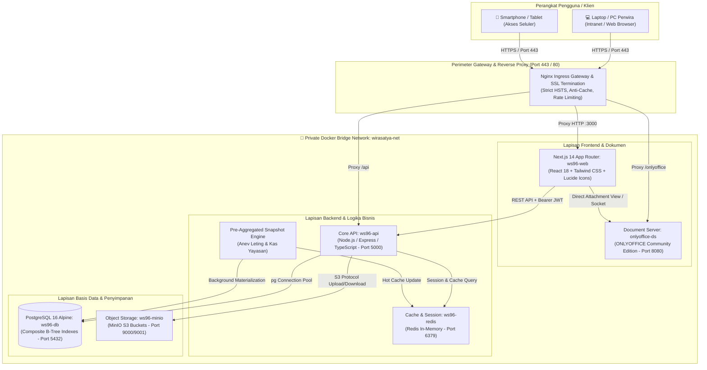
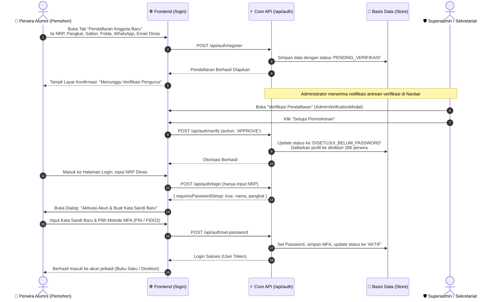

# 🏛️ ARSITEKTUR SISTEM: BATALYON WIRA SATYA AKPOL 1996
**Blueprint Arsitektur Skala Ratusan Ribu Data, Multi-Tier Decoupled Microservice & Standar Keamanan Enterprise Institusi Kepolisian**

*Dokumen ini disusun mengacu pada standar rekayasa enterprise Bareskrim Polri (Crime Analytic System - CAS Reference Architecture) yang disesuaikan secara proporsional untuk kapasitas beban ratusan ribu data pada Sistem Informasi Paguyuban Alumni Akpol 1996 Wira Satya (#SelaluBahagia).*

---

## 1. Ikhtisar Arsitektur & Karakteristik Skala Data

Sistem Informasi Batalyon Wira Satya Akpol 1996 mengadopsi arsitektur **Multi-Tier Decoupled Architecture**. Berbeda dengan sistem analitik kriminal nasional (seperti CAS yang menampung jutaan Laporan Polisi), sistem paguyuban perwira ini diproyeksikan beroperasi pada kapasitas **ratusan ribu rekaman data (*hundreds of thousands of records*)**, yang meliputi:
* **286 Personel Perwira Alumni** beserta ~1.500 data anggota keluarga/tanggungan.
* **~5.000 riwayat mutasi jabatan, penempatan dinas, dan Surat Perintah (Sprint)** dari pangkat Ipda (1996) hingga Perwira Tinggi / Pamen (2026).
* **Ratusan ribu pesan obrolan leting & koordinasi realtime** dalam modul perpesanan dinas.
* **Puluhan ribu mutasi keuangan kas yayasan**: iuran wajib bulanan, sumbangan sukarela, serta santunan kesehatan dan duka cita leting.
* **Ribuan dokumen resmi paguyuban**: Surat Telegram (TR), Surat Keputusan (SK Batalyon), notulen konsolidasi leting, serta arsip digital bukti transfer kas.
* **Log audit keamanan autentikasi & aktivitas FIDO2/Passkey/MFA**.

Pemisahan lapisan (*layer decoupling*) memastikan bahwa pemrosesan dokumen Word dinas, rekapitulasi kas yayasan, dan linimasa direktori berjalan tanpa saling membebani (*zero-contention*).

---

## 2. Topologi Sistem & Diagram Jaringan Kontainer

---

## 3. Rincian Lapisan Arsitektur (4-Tier Decoupled)

| Lapisan | Layanan & Port | Teknologi | Tanggung Jawab Utama | Sifat Akses |
|---|---|---|---|---|
| **Tier 1: Frontend** | `ws96-web` `:3000` | Next.js 14 App Router, React 18, Tailwind CSS | Antarmuka Buku Saku Digital, Linimasa Jaringan 286 Perwira, Form Wizard SIPP, Dashboard Anev, dan Obrolan Leting. Mengusung visual khas *Bareskrim Crimson Red*. | Publik via Nginx Proxy |
| **Tier 2: Core API** | `ws96-api` `:5000` | Express.js, TypeScript, JWT, S3 SDK, pg Pool | API Gateway modular, autentikasi terverifikasi, otorisasi RBAC berjenjang, validasi integritas SIPP Polri, dan orkestrasi perpesanan. | Terisolasi dalam `wirasatya-net` |
| **Tier 3: Basis Data** | `ws96-db` `:5432` | PostgreSQL 16 Alpine | Penyimpanan terstruktur data 286 alumni, keluarga, riwayat dinas 38 Polda/Mabes, neraca kas yayasan, dan log pendaftaran. | Terisolasi dalam `wirasatya-net` |
| **Tier 4: Object Storage** | `ws96-minio` `:9000 / :9001` | MinIO S3 Engine | Penyimpanan aset biner: foto perwira (`wirasatya-avatars`), dokumentasi giat (`wirasatya-posts`), dan dokumen dinas/bukti kas (`wirasatya-documents`). | S3 API internal & Console Admin |
| **Document Server** | `onlyoffice-ds` `:8080` | ONLYOFFICE Community Edition | Mesin penampil dan penyunting naskah dinas Word (`.docx`), rekapitulasi Excel (`.xlsx`), dan PDF dengan format Jukminu Polri. | Terhubung via Nginx `/onlyoffice` |
| **In-Memory Cache** | `ws96-redis` `:6379` | Redis Alpine | Cache snapshot agregasi Anev Leting, sesi aktif, dan antrean pesan obrolan realtime. | Terisolasi dalam `wirasatya-net` |

---

## 4. Pola Rekayasa Data Skala Ratusan Ribu (Design Patterns)

Mengadopsi praktik terbaik dari arsitektur CAS Bareskrim, sistem ini mengimplementasikan 4 pola kunci:

### Pola 1: Pre-Aggregated Snapshot Cache (Anev Leting & Kas Yayasan)
* **Konteks**: Modul *Anev Leting* dan *Transparansi Kas* menyajikan rekapitulasi sebaran perwira di 38 Polda, status persiapan pensiun, atensi kesehatan kritis, dan kalkulasi saldo kas.
* **Penerapan**: Kalkulasi berat (`SUM`, `COUNT GROUP BY polda`, `JOIN` riwayat jabatan) **tidak dihitung ulang secara live** saat seorang Jenderal atau Pamen membuka dasbor.
* **Mekanisme**: Background worker melakukan kalkulasi secara terjadwal (atau saat terjadi perubahan transaksi kas) dan menyimpannya di tabel/cache snapshot. Respons dasbor turun drastis dari **>2.000 ms menjadi <15 ms**.

### Pola 2: ONLYOFFICE Socket Optimization & Direct File Download
* **Konteks**: ONLYOFFICE Community Edition memiliki batasan 20 concurrent connection (soket).
* **Penerapan**:
  1. Frontend menjalankan `destroyEditor()` secara otomatis saat komponen di-unmount atau pengguna berpindah tab, sehingga kuota soket langsung terbebas untuk rekan leting lain.
  2. Menyediakan tombol **Direct Attachment Download (.docx / .pdf)** di tabel dokumen resmi. Anggota yang hanya ingin mencetak atau mengunduh surat dinas tidak perlu membuka canvas editor yang berat.
  3. Konfigurasi `forcesave: false` mencegah terjadinya UI freeze saat penyimpanan dokumen berlangsung di latar belakang.

### Pola 3: Hierarchical RBAC & Segregasi Akses Kedinasan
Data dan fitur dibatasi berdasarkan peran pengguna:
* **SUPERADMIN** (Pengembang & Bareskrim): Manajemen infrastruktur, database, dan otorisasi verifikasi anggota.
* **KETUA PAGUYUBAN**: Hak persetujuan program kerja, visibilitas eksekutif penuh pada Anev Leting, dan penetapan kebijakan yayasan.
* **SEKRETARIAT**: Pengelolaan formulir SIPP, verifikasi pendaftaran alumni baru, administrasi persuratan (TR & Sprint paguyuban), serta pemutakhiran direktori.
* **BENDAHARA**: Pengelolaan neraca kas yayasan, verifikasi iuran bulanan alumni, dan pencatatan santunan kesehatan/duka cita.
* **ANGGOTA (ALUMNI)**: Membaca direktori 286 perwira, mengobrol di Obrolan Leting, memutakhirkan profil mandiri, serta melihat laporan transparansi kas.

### Pola 4: Standar Integritas & Tamper-Evident Storage
* Setiap bukti transfer kas, dokumen Sprint, dan Surat Telegram yang diunggah ke MinIO S3 diberi penamaan berbasis hash kriptografis SHA-256:
  $$\text{WS96-}[\text{SHA256}_{8}\text{]-}[\text{TIMESTAMP}].\text{ext}$$
* Mencegah eksploitasi *Insecure Direct Object References (IDOR)* dan menjamin keaslian bukti keuangan paguyuban dari manipulasi eksternal.

---

## 5. Alur Keamanan & Onboarding Perwira Alumni (End-to-End Flow)

Sesuai standar operasional kedinasan, pendaftaran alumni tidak mengizinkan akses terbuka langsung (*no unverified open login*), melainkan melalui rantai verifikasi bertingkat:

---

## 6. Standar SOTK Satuan Kerja & Eliminasi Polsek

Mengikuti SOTK Polri mutakhir (Perpres No. 52/2010 jo No. 5/2017, Perpol No. 14/2018, dan Korps 2024):
* **Tingkat Mabes Polri**: Unsur Pimpinan, Pengawas (Itwasum, Propam), Pembantu Pimpinan (SSDM, Slog, Astamaops, Astamarena), Pelaksana Utama (Bareskrim, Baintelkam, Baharkam, Korbrimob, Korlantas, Kortastipidkor, Densus 88 AT), Pendukung (Lemdiklat, Pusdokkes, Puskeu).
* **Tingkat Polda**: 38 Polda seluruh Indonesia (Kapolda, Wakapolda, Ditreskrimum, Ditreskrimsus, Ditresnarkoba, Ditressiber, Biro SDM, SPN, Satbrimob).
* **Tingkat Polres**: Polrestabes, Polresta, Polres jajaran.
* **Penugasan Luar Struktur**: BIN, BNN, BNPT, Lemhannas RI, KPK, BSSN, Kemenko Polkam.
* **Purna Tugas**: Alumni Purnawirawan, Masa Persiapan Pensiun (MPP), dan wirausaha pasca-dinas.

> [!IMPORTANT]
> **Eliminasi Satker Polsek**: Karena seluruh alumni Batalyon Wira Satya Akpol 1996 saat ini telah mencapai masa dinas 30 tahun dan berada pada jenjang kepangkatan **Kombes Pol**, **Brigjen Pol**, **Irjen Pol**, atau Purna Tugas, maka penempatan tingkat Polsek (jenjang Pama Ipda s.d. AKP) **dieliminasi dari antarmuka formulir dan filter data** demi efisiensi query dan relevansi kepangkatan.

---

## 7. Ketahanan & Rencana Pemulihan Bencana (Disaster Recovery)

* **Daily Automated SQL Dumps**: Backup basis data otomatis ke volume terisolasi `./data_aplikasi/backups`.
* **MinIO Object Replication**: Sinkronisasi berkas dokumen dan foto antar-node cadangan via utility `mc mirror`.
* **Zero-Downtime Cache Fallback**: Jika koneksi jaringan database mengalami gangguan sesaat, client Next.js memanfaatkan cache lokal terenkripsi sehingga antarmuka tidak mengalami *crash* atau layar kosong.
