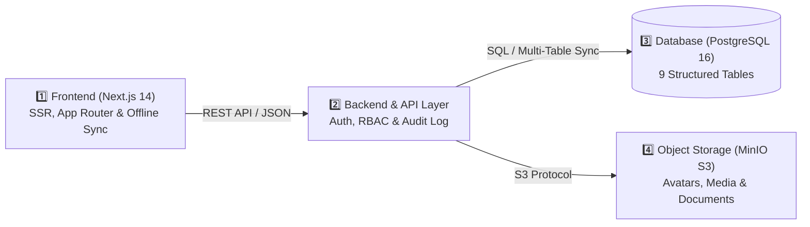

<div align="center">

# 🏛️ WIRA SATYA 1996 ALUMNI INFORMATION SYSTEM
### Integrated Digital Directory, Tour of Duty Mapping, Social Feed, & Treasury Transparency Platform for the 1996 Police Academy (Akpol) Battalion

[](./README.id.md)
[](./README.en.md)

[](https://nextjs.org/)
[](https://www.typescriptlang.org/)
[](https://tailwindcss.com/)
[](https://www.docker.com/)
[](https://www.postgresql.org/)
[](https://min.io/)

<br/>

**[🌐 Open Live Portal](https://wirasatya96.vercel.app)** · **[📖 Architecture Specification](./ARCHITECTURE.md)** · **[🛡️ Security Policy](./SECURITY.md)** · **[🤝 Contributing Guide](./CONTRIBUTING.md)**

</div>

---

> [!NOTE]
> **Wira Satya Battalion 1996 — #SelaluBahagia**
> An internal community & executive portal for alumni officers of the 1996 Indonesian National Police Academy (*United, Caring, & Serving Since 1996*). It integrates nationwide organizational placement mapping (National Police Headquarters / Mabes Polri, 38 Regional Police Commands / Polda, Resort Commands, and External Ministry/Agency Assignments), **28 Police Functional Categories (*Tour of Duty*)**, an interactive alumni timeline, a transparent **Treasury Ledger** split into **Social Funds (*Dana Sosial*)** & **Investment Funds (*Dana Investasi*)** with editable **Crowdfunding / Milestone Campaigns**, healthcare attention tracking, and retirement readiness analytics.

> [!IMPORTANT]
> **Public Repository Security & Zero Data Leak Policy**:
> This repository is strictly sanitized for public visibility. All authentication credentials, cryptographic signing keys (`JWT_SECRET`), production database endpoints, and sensitive personnel records are isolated via environment variables (`.env`) and enforced by hierarchical Role-Based Access Control (RBAC). No plaintext passwords, private keys, or sensitive personal records are stored in the public source code.

---

## 📑 Table of Contents

1. [Executive Summary & System Architecture](#-executive-summary--system-architecture)
2. [Core Platform Modules](#-core-platform-modules)
3. [Adaptive Responsive Design (Desktop PC vs Mobile Smartphone)](#-adaptive-responsive-design-desktop-pc-vs-mobile-smartphone)
4. [Organizational Structure & 28 Police Functions](#-organizational-structure--28-police-functions)
5. [Repository Directory Structure](#-repository-directory-structure)
6. [Quick Start Guide (Docker Compose)](#-quick-start-guide-docker-compose)
7. [Running Locally (Standalone Development Mode)](#-running-locally-standalone-development-mode)
8. [Environment Variables Configuration (`.env`)](#-environment-variables-configuration-env)
9. [Role-Based Access Control (RBAC) Authority Matrix](#-role-based-access-control-rbac-authority-matrix)
10. [License & Security Policy](#-license--security-policy)

---

## 🏛️ Executive Summary & System Architecture

The platform is built upon a **Multi-Tier Decoupled & Cloud-Synced Architecture**, ensuring high availability, sub-second responsiveness across mobile and desktop devices, and resilient offline-first fallback capabilities:



- **Tier 1 — Presentation & Adaptive UI**: Next.js 14 App Router styled in the signature *Bareskrim Crimson Red* (`#8B0000`) & *Officer Gold* (`#D97706`) theme, supporting multi-factor authentication (Security PIN & FIDO2/WebAuthn Biometrics) and an *Offline Sync Engine*.
- **Tier 2 — Application & Security API**: Modular REST API enforcing schema validation, hierarchical Role-Based Access Control (RBAC), Aide-de-Camp (*ADC Delegation Mode*), and automated tamper-evident audit logging.
- **Tier 3 — Relational Persistence**: PostgreSQL 16 (featuring a 9-table structured schema for concurrent multi-user cloud synchronization without write contention).
- **Tier 4 — Object Storage**: MinIO S3-compatible storage segregating public media buckets from private document buckets (`wirasatya-avatars`, `wirasatya-posts`, `wirasatya-documents`).

---

## 🌟 Core Platform Modules

| Module | Icon | Key Features & Capabilities | Target Users |
| :--- | :---: | :--- | :--- |
| **Home & Alumni Timeline (Feed)** | 💬 | Interactive social feed with infinite scroll, 6 custom battalion reactions, nested comments, and quick-access summary cards for *Tour of Duty*, *Healthcare Attention*, and *Social & Investment Funds*. | All Alumni |
| **Network & Digital Pocketbook** | 📖 | Comprehensive alumni directory with regional filters (Mabes Polri, 38 Regional Commands/Polda, External Agencies), smart default sorting (`Active → Retired → PTDH → Deceased`), and one-click WhatsApp contact for officers & their Aide-de-Camp (ADC). | All Alumni & Board |
| **Positions & Tour of Duty** | 🎖️ | Career history and assignment tracking across **28 Police Functions**, complete with mutation order (TR) references and operational/innovation achievements. | All Alumni & HR |
| **Treasury Ledger (*Buku Kas*)** | 💰 | Dual-pillar financial transparency divided into **Social Funds (*Dana Sosial*)** (annual dues, voluntary contributions, medical assistance, bereavement funds) and **Investment Funds (*Dana Investasi*)** (time deposits, government bonds/SBN, gold bullion, business units, property), plus editable **Crowdfunding / Milestone Campaigns**. | Treasurer, Board & Alumni |
| **Battalion Analytics & Healthcare** | 🩺 | Real-time monitoring of colleagues or family members undergoing medical care/hospitalization, enabling coordinated support and prayers. | Welfare Division & Leadership |
| **Retirement Readiness & Ventures** | 👔 | Mandatory retirement age (58 years) projection, post-service residential mapping, and a directory of alumni-owned enterprises. | All Alumni |
| **User Management & Audit Log** | 🛡️ | New member verification queue, hierarchical user management, Aide-de-Camp (ADC) account delegation, soft-delete account recovery (*Restore User*), and comprehensive *Audit Logs*. | Superadmin, Chairman & Secretary |

---

## 📱 Adaptive Responsive Design (Desktop PC vs Mobile Smartphone)

The user interface is engineered specifically to optimize both Desktop and Mobile workflows:
- **Desktop / PC View (`lg:`)**:
  - Preserves the full 3-column executive layout on the Home page (Left Rail: *My Profile*, *Tour of Duty*, & `#SELALUBAHAGIA` card; Center Feed: *Post Composer*, *Timeline Filters*, & *Feed*; Right Rail: *Healthcare Attention*, *Social & Investment Funds*, & *Batalyon Wira Satya 1996* identity footer).
  - Displays complete, descriptive button and badge labels across all menus.
- **Mobile / Smartphone View (`< lg`)**:
  - **Collapsible Summary Card Headers**: Summary cards (*My Profile*, *Tour of Duty*, *Healthcare Attention*, *Social & Investment Funds*) render as compact single-line headers on mobile and expand smoothly when tapped to reveal details and navigation links.
  - **Self-Contained Infinite Scroll Feed**: On mobile devices, the Home feed scrolls within a dedicated container so continuous scrolling loads additional posts without pushing the `#SELALUBAHAGIA` card and the `BATALYON WIRA SATYA 1996` footer out of reach at the bottom.
  - **Concise Mobile Labels & `(i)` Tooltips**: Button labels automatically switch to concise single-line text on mobile screens (`sm:hidden`) paired with touch-friendly info tooltips to prevent layout wrapping.

---

## 👮 Organizational Structure & 28 Police Functions

The system models the latest Indonesian National Police organizational structure (SOTK Polri):
1. **Assignment Levels**:
   - **National Headquarters (*Mabes Polri*)**: Leadership, Supervisory, Main Operational, and Support Elements.
   - **38 Regional Commands (*Polda*) & Territorial Units**: Covering all 38 provinces and subordinate Resort/Metropolitan commands.
   - **External Assignments (*Luar Struktur*)**: Officers seconded to Ministries, National Agencies, and State Commissions.
2. **28 Police Functional Categories (*Tour of Duty*)**:
   `Wasum`, `Rena`, `Ops`, `Lemdiklat`, `Reserse`, `Intelkam`, `Harkam`, `Brimob`, `Slog`, `Sahli`, `Lantas`, `Densus`, `Humas`, `Propam`, `Hukum`, `Hubinter`, `TIK`, `SDM`, `Taspidkor`, `Keu`, `Dokkes`, `Litbang`, `Sejarah`, `Setum`, `Yanma`, `Spripim`, `Kewilayahan`, and `Luar Struktur`.
3. **Service Status & Automated Dues Exemption**:
   - **Active (*Aktif*)** personnel are automatically included in annual membership dues tracking.
   - **Retired (*Purna Tugas*)**, **PTDH**, and **Deceased (*Almarhum/Gugur*)** personnel are automatically marked as **Exempt from Dues (*Bebas Iuran*)**.

---

## 📁 Repository Directory Structure

```text
wirasatya96/
├── backend/                       # [Tier 2] Express REST API & TypeScript Service
│   ├── src/
│   │   ├── config/                # PostgreSQL Pool & MinIO S3 Client Configuration
│   │   ├── routes/                # Modular REST Endpoints (Auth, Members, Posts, Finance)
│   │   └── index.ts               # Express Server Entrypoint
│   ├── backend.Dockerfile         # Backend Container Dockerfile
│   └── .env.example               # Sanitized Backend Environment Template
├── database/                      # [Tier 3] Relational Database Schemas
│   ├── init.sql                   # PostgreSQL DDL Schema & Sanitized Reference Data
│   └── supabase_setup.sql         # 9-Table Structured Cloud Sync Schema
├── minio/                         # [Tier 4] MinIO S3 Bucket Initialization Scripts
├── src/                           # [Tier 1] Next.js 14 Web Application (App Router)
│   ├── app/                       # App Router Pages, Layouts, & API Route Handlers
│   ├── components/                # UI Components (BukuSaku, BendaharaPortal, Jobs, Network, etc.)
│   ├── data/                      # SOTK Polri Reference, 28 Functions, & Data Models
│   ├── lib/                       # Cloud Sync Engine, Offline Cache, & Server Store
│   └── types/                     # Centralized TypeScript Interfaces
├── .env.example                   # Main Sanitized Environment Variables Template
├── docker-compose.yml             # 4-Tier Container Orchestration
├── README.md                      # Bilingual Main Documentation (Indonesian & English)
├── README.id.md                   # Complete Documentation in Bahasa Indonesia
├── README.en.md                   # Complete Documentation in English
├── ARCHITECTURE.md                # Technical & System Architecture Specification (ID/EN)
├── SECURITY.md                    # Security & Data Privacy Policy (ID/EN)
└── CONTRIBUTING.md                # Developer Contribution Guidelines (ID/EN)
```

---

## 🚀 Quick Start Guide (Docker Compose)

The fastest way to launch the entire stack (Frontend, Backend, PostgreSQL, and MinIO) is via **Docker Compose**:

### 1. Clone the Repository & Configure Environment Variables:
```bash
git clone https://github.com/omeko11/wirasatya96.git
cd wirasatya96
cp .env.example .env
```
*(Update the placeholder secret values in your local `.env` file before deploying to production).*

### 2. Start All Containers:
```bash
docker-compose up --build -d
```

### 3. Access the Services:
- **Frontend Web Portal**: `http://localhost:3000`
- **Backend API Healthcheck**: `http://localhost:5000/api/health`
- **MinIO Storage Console**: `http://localhost:9001`
- **PostgreSQL Port**: `localhost:5432`

---

## 💻 Running Locally (Standalone Development Mode)

```bash
# 1. Install dependencies in the root directory
npm install

# 2. Copy the local environment template
cp .env.example .env

# 3. Start the Next.js development server
npm run dev

# 4. Run TypeScript type-checking & production build verification
npx tsc --noEmit
npm run build
```

---

## ⚙️ Environment Variables Configuration (`.env`)

All sensitive credentials must be stored exclusively in your local `.env` file (which is excluded via `.gitignore`). Refer to [`.env.example`](./.env.example):

| Category | Variable Name | Required | Description |
| :--- | :--- | :---: | :--- |
| **Frontend** | `NEXT_PUBLIC_API_URL` | Yes | Backend API Gateway URL (`http://localhost:5000/api`) |
| **Cloud Sync** | `NEXT_PUBLIC_SUPABASE_URL` | Optional | PostgreSQL/Supabase project URL for multi-table cloud sync |
| | `NEXT_PUBLIC_SUPABASE_ANON_KEY` | Optional | Public anonymous key protected by Row-Level Security (RLS) |
| | `SUPABASE_SERVICE_ROLE_KEY` | Optional | Server-side key for authorized synchronization operations |
| **Backend** | `JWT_SECRET` | Yes | Cryptographic secret key used to sign JWT session tokens |
| **Database** | `DB_HOST`, `DB_PORT`, `DB_NAME` | Yes | PostgreSQL host, port (`5432`), and database name |
| | `DB_USER`, `DB_PASSWORD` | Yes | PostgreSQL database authentication credentials |
| **Storage (S3)** | `MINIO_ENDPOINT`, `MINIO_ACCESS_KEY`, `MINIO_SECRET_KEY` | Yes | MinIO S3 endpoint and access credentials |

---

## 👥 Role-Based Access Control (RBAC) Authority Matrix

The platform enforces strict Separation of Duties across five user tiers:

| Role | Scope of Authority & Primary Responsibilities |
| :--- | :--- |
| **1. SUPERADMIN** | Full system configuration control, user account lifecycle management & restoration, and database maintenance. |
| **2. CHAIRMAN (*KETUA*)** | Full access to the *Executive Dashboard* (*Anev Leting*), regional distribution & healthcare monitoring, and subordinate user management. |
| **3. SECRETARY (*SEKRETARIS*)** | Verification of new member registrations, directory updates across 38 Polda/Mabes, mutation order (TR) administration, and member account management. |
| **4. TREASURER (*BENDAHARA*)** | Full management of the *Treasury Ledger* (**Social Funds** & **Investment Funds**), creation/editing of **Crowdfunding Campaigns**, and dues verification. |
| **5. MEMBER & ADC (*ANGGOTA*)** | Access to the Digital Directory, participation in the Timeline & Messaging, self-service profile updates (or via audited Aide-de-Camp/ADC delegation), and treasury transparency. |

---

## 📄 License & Security Policy

- **Copyright**: © 2026 Alumni Association of the 1996 Indonesian National Police Academy — Wira Satya Battalion. All rights reserved.
- **Security Policy**: Read [SECURITY.md](./SECURITY.md) for data isolation details and Private Vulnerability Reporting procedures.
- **Contributing**: Read [CONTRIBUTING.md](./CONTRIBUTING.md) for coding standards and commit conventions before submitting a Pull Request.

<div align="center">
  <sub>Wira Satya Battalion Akpol 1996 • <i>United, Caring, & Serving Since 1996 — #SelaluBahagia</i></sub>
</div>
