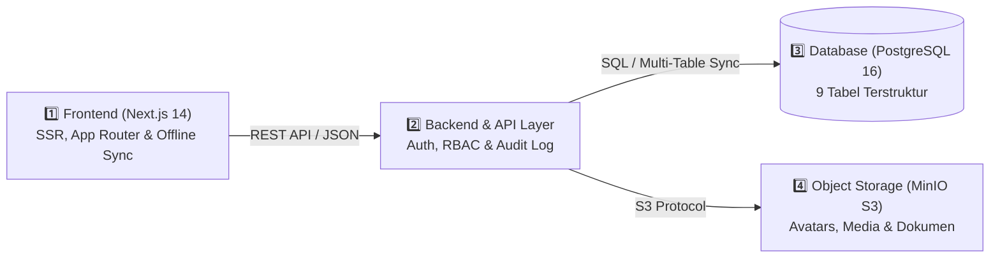

<div align="center">

# 🏛️ SISTEM INFORMASI BATALYON WIRA SATYA AKPOL 1996
### Platform Terpadu Buku Saku Digital, Pemetaan Penugasan (*Tour of Duty*), Linimasa Silaturahmi, serta Transparansi Dana Sosial & Investasi Alumni Akpol 1996

[](./README.id.md)
[](./README.en.md)

[](https://nextjs.org/)
[](https://www.typescriptlang.org/)
[](https://tailwindcss.com/)
[](https://www.docker.com/)
[](https://www.postgresql.org/)
[](https://min.io/)

<br/>

**[🌐 Buka Portal Produksi](https://wirasatya96.vercel.app)** · **[📖 Spesifikasi Arsitektur](./ARCHITECTURE.md)** · **[🛡️ Kebijakan Keamanan](./SECURITY.md)** · **[🤝 Panduan Kontribusi](./CONTRIBUTING.md)**

</div>

---

> [!NOTE]
> **Batalyon Wira Satya 1996 — #SelaluBahagia**
> Platform informasi internal paguyuban perwira alumni Akademi Kepolisian 1996 (*Guyub, Peduli, & Mengabdi Sejak 1996*). Mengintegrasikan direktori penempatan tugas SOTK Polri (Mabes Polri, 38 Polda, Polres/Polrestabes/Metro, dan Penugasan Luar Struktur Kemen/Lembaga), pemetaan 28 fungsi kepolisian (*Tour of Duty*), linimasa silaturahmi leting, sistem **Buku Kas** (**Dana Sosial** & **Dana Investasi**) beserta kampanye **Penggalangan Dana (*Crowdfunding Milestone*)**, hingga pemetaan kesiapan purna tugas dan atensi kesehatan keluarga besar.

> [!IMPORTANT]
> **Kebijakan Privasi & Keamanan Data Publik (*Zero Data Leak*)**:
> Repositori ini dikonfigurasi aman untuk publik. Seluruh kredensial autentikasi, kunci enkripsi (`JWT_SECRET`), koneksi basis data produksi, serta data sensitif personel diisolasi menggunakan variabel lingkungan (`.env`) dan kebijakan kontrol akses berjenjang (*Role-Based Access Control*). Tidak ada kata sandi, kunci rahasia, atau data pribadi sensitif yang disertakan dalam kode sumber publik.

---

## 📑 Daftar Isi

1. [Ringkasan Eksekutif & Arsitektur Sistem](#-ringkasan-eksekutif--arsitektur-sistem)
2. [Fitur-Fitur Utama Platform](#-fitur-fitur-utama-platform)
3. [Desain Responsif Adaptif (Desktop PC vs Smartphone HP)](#-desain-responsif-adaptif-desktop-pc-vs-smartphone-hp)
4. [Struktur Organisasi & 28 Fungsi Kepolisian](#-struktur-organisasi--28-fungsi-kepolisian)
5. [Struktur Direktori Repositori](#-struktur-direktori-repositori)
6. [Panduan Memulai Cepat (Docker Compose)](#-panduan-memulai-cepat-docker-compose)
7. [Menjalankan Proyek Secara Lokal (Development Mode)](#-menjalankan-proyek-secara-lokal-development-mode)
8. [Konfigurasi Variabel Lingkungan (`.env`)](#-konfigurasi-variabel-lingkungan-env)
9. [Matriks Otoritas & Hak Akses Berjenjang (RBAC)](#-matriks-otoritas--hak-akses-berjenjang-rbac)
10. [Lisensi & Kebijakan Keamanan](#-lisensi--kebijakan-keamanan)

---

## 🏛️ Ringkasan Eksekutif & Arsitektur Sistem

Sistem dibangun dengan paradigma **Multi-Tier Decoupled & Cloud-Synced Architecture** untuk menjamin keandalan, kecepatan akses di perangkat seluler maupun desktop, serta ketahanan data (*offline-first fallback*):



- **Tier 1 — Presentation & Responsive UI**: Next.js 14 App Router dengan tema resmi *Bareskrim Crimson Red* (`#8B0000`) & *Gold Kehormatan* (`#D97706`), mendukung autentikasi multi-faktor (PIN & Biometrik FIDO2/WebAuthn) serta *Offline Sync Engine*.
- **Tier 2 — Application & Security API**: Layanan API terukur dengan validasi skema, otorisasi berbasis peran (*Multi-Role RBAC*), dukungan delegasi Ajudan (*ADC Mode*), dan pencatatan log audit otomatis.
- **Tier 3 — Relational Persistence**: PostgreSQL 16 (mendukung skema 9 tabel terpisah untuk sinkronisasi cloud multi-input tanpa konflik data).
- **Tier 4 — Object Storage**: MinIO S3 Server dengan pemisahan bucket publik dan privat (`wirasatya-avatars`, `wirasatya-posts`, `wirasatya-documents`).

---

## 🌟 Fitur-Fitur Utama Platform

| Modul | Ikon | Deskripsi & Fungsionalitas Utama | Pengguna Sasaran |
| :--- | :---: | :--- | :--- |
| **Beranda & Linimasa Silaturahmi** | 💬 | Feed publikasi giat leting dengan *infinite scroll*, 6 reaksi khas (*Siap, Mantap, Hormat, Peduli, Semangat, Terharu*), komentar bersarang, serta ringkasan cepat *Tour of Duty*, *Atensi Kesehatan*, dan *Dana Sosial & Investasi*. | Seluruh Alumni |
| **Jejaring & Buku Saku Digital** | 📖 | Direktori perwira alumni dengan filter wilayah (Mabes Polri, 38 Polda, Luar Struktur), pengurutan cerdas (`Aktif → Purna → PTDH → Almarhum`), serta kontak cepat WhatsApp Perwira & Ajudan (ADC). | Seluruh Alumni & Pengurus |
| **Jabatan & Tour of Duty** | 🎖️ | Pemetaan penugasan personel berdasarkan TR Kapolri dan **28 Fungsi Kepolisian**, dilengkapi pencarian riwayat jabatan dan pencatatan prestasi operasional/inovasi. | Seluruh Alumni & SDM |
| **Buku Kas (Dana Sosial & Investasi)** | 💰 | Transparansi perbendaharaan angkatan yang terbagi menjadi **Dana Sosial** (iuran wajib, sukarela, santunan sakit, dana duka) & **Dana Investasi** (deposito, obligasi/SBN, emas/logam mulia, unit usaha, properti), dilengkapi fitur **Penggalangan Dana (*Crowdfunding Milestone*)** yang dapat diedit oleh pengurus. | Bendahara, Pengurus & Alumni |
| **Anev Leting & Kesehatan** | 🩺 | Panel monitoring rekan atau keluarga yang membutuhkan pendampingan medis/rawat inap beserta koordinasi dukungan doa & bantuan sosial. | Bidang Kesejahteraan & Pimpinan |
| **Kesiapan Purna Tugas & Usaha** | 👔 | Pemetaan masa purna bhakti (BUP 58 tahun), sebaran domisili/hunian pasca-dinas, serta katalog unit usaha mandiri rekan leting. | Seluruh Alumni |
| **Manajemen Pengguna & Log Audit** | 🛡️ | Panel verifikasi pendaftar baru, pengelolaan akun berjenjang, delegasi akun Ajudan (ADC), fitur pemulihan akun terhapus (*Restore User*), serta rekam jejak audit (*Audit Log*). | Superadmin, Ketua & Sekretaris |

---

## 📱 Desain Responsif Adaptif (Desktop PC vs Smartphone HP)

Antarmuka dirancang khusus agar memberikan pengalaman terbaik di kedua jenis perangkat:
- **Tampilan Desktop / PC (`lg:`)**:
  - Menampilkan tata letak 3 kolom utuh di Beranda (Kolom Kiri: *Profil Saya*, *Tour of Duty*, & kartu `#SELALUBAHAGIA`; Kolom Tengah: *Buat Postingan*, *Filter Linimasa*, & *Feed*; Kolom Kanan: *Atensi Kesehatan*, *Dana Sosial & Investasi*, & identitas *Batalyon Wira Satya 1996*).
  - Menampilkan teks tombol dan label informasi secara lengkap dan deskriptif.
- **Tampilan Smartphone / HP (`< lg`)**:
  - **Header Kartu Buka-Tutup (*Collapsible Cards*)**: Kartu ringkasan (*Profil Saya*, *Tour of Duty*, *Atensi Kesehatan*, *Dana Sosial & Investasi*) tampil ringkas hanya bagian *header* dan dapat diklik untuk membuka detail serta tombol navigasi menu.
  - **Infinite Scroll Feed Terjaga**: Daftar postingan di Beranda HP memiliki kontainer gulir mandiri sehingga saat digulir terus-menerus tidak menenggelamkan kartu `#SELALUBAHAGIA` dan identitas `BATALYON WIRA SATYA 1996` di bagian paling bawah.
  - **Efisiensi Kata & Tooltip `(i)`**: Label tombol diringkas khusus pada layar HP agar tidak turun baris, dilengkapi *tooltip* informasi ramah layar sentuh.

---

## 👮 Struktur Organisasi & 28 Fungsi Kepolisian

Sistem mendukung pemetaan penugasan berdasarkan SOTK Polri terkini:
1. **Tingkat Penempatan**:
   - **Mabes Polri** (Unsur Pimpinan, Pengawas/Pembantu Pimpinan, Pelaksana Tugas Pokok, Pendukung).
   - **38 Polda Kewilayahan** beserta Polres/Polrestabes/Polresta jajaran.
   - **Penugasan Luar Struktur** pada Kementerian, Badan, dan Lembaga Negara.
2. **28 Fungsi Kepolisian (*Tour of Duty*)**:
   `Wasum`, `Rena`, `Ops`, `Lemdiklat`, `Reserse`, `Intelkam`, `Harkam`, `Brimob`, `Slog`, `Sahli`, `Lantas`, `Densus`, `Humas`, `Propam`, `Hukum`, `Hubinter`, `TIK`, `SDM`, `Taspidkor`, `Keu`, `Dokkes`, `Litbang`, `Sejarah`, `Setum`, `Yanma`, `Spripim`, `Kewilayahan`, dan `Luar Struktur`.
3. **Klasifikasi Status Kedinasan & Aturan Iuran Otomatis**:
   - Personel berstatus **Aktif** tercatat dalam rekapitulasi iuran tahunan.
   - Personel berstatus **Purna Tugas**, **PTDH**, dan **Almarhum/Gugur** secara otomatis ditandai **Bebas Iuran / Dikecualikan**.

---

## 📁 Struktur Direktori Repositori

```text
wirasatya96/
├── backend/                       # [Tier 2] Layanan Express REST API & TypeScript
│   ├── src/
│   │   ├── config/                # Konfigurasi koneksi PostgreSQL & MinIO S3
│   │   ├── routes/                # Endpoint REST modular (Auth, Members, Posts, Finance)
│   │   └── index.ts               # Entrypoint server backend
│   ├── backend.Dockerfile         # Dockerfile kontainer Backend
│   └── .env.example               # Template variabel lingkungan Backend (Tanpa Kredensial)
├── database/                      # [Tier 3] Skema Basis Data Relasional
│   ├── init.sql                   # Skema DDL PostgreSQL & data referensi awal (Sanitized)
│   └── supabase_setup.sql         # Skema 9 tabel terstruktur untuk sinkronisasi cloud
├── minio/                         # [Tier 4] Skrip Inisialisasi Bucket MinIO S3
├── src/                           # [Tier 1] Aplikasi Web Next.js 14 (App Router)
│   ├── app/                       # Halaman utama, login, dan Route Handlers API
│   ├── components/                # Komponen UI (BukuSaku, BendaharaPortal, Jobs, Network, dll.)
│   ├── data/                      # Referensi SOTK Polri, 28 Fungsi, & Struktur Data
│   ├── lib/                       # Mesin sinkronisasi cloud, offline cache, & store
│   └── types/                     # Definisi tipe TypeScript terpusat
├── .env.example                   # Template variabel lingkungan utama (Aman untuk Publik)
├── docker-compose.yml             # Orkestrasi kontainer (Frontend, Backend, Postgres, MinIO)
├── README.md                      # Dokumentasi Utama Dwibahasa (Indonesia & Inggris)
├── README.id.md                   # Dokumentasi Lengkap Bahasa Indonesia
├── README.en.md                   # Dokumentasi Lengkap Bahasa Inggris (English)
├── ARCHITECTURE.md                # Spesifikasi Teknis & Arsitektur Sistem (ID/EN)
├── SECURITY.md                    # Kebijakan Keamanan & Privasi Data (ID/EN)
└── CONTRIBUTING.md                # Panduan Kontribusi Pengembang (ID/EN)
```

---

## 🚀 Panduan Memulai Cepat (Docker Compose)

Cara tercepat untuk menjalankan seluruh layanan (Frontend, Backend, PostgreSQL, dan MinIO) secara terisolasi adalah menggunakan **Docker Compose**:

### 1. Kloning Repositori & Siapkan Variabel Lingkungan:
```bash
git clone https://github.com/omeko42/wirasatya96.git
cd wirasatya96
cp .env.example .env
```
*(Sesuaikan nilai kunci rahasia pada berkas `.env` lokal Anda sebelum menjalankan di lingkungan produksi).*

### 2. Jalankan Seluruh Kontainer:
```bash
docker-compose up --build -d
```

### 3. Akses Layanan:
- **Portal Web Frontend**: `http://localhost:3000`
- **Backend API Healthcheck**: `http://localhost:5000/api/health`
- **MinIO Storage Console**: `http://localhost:9001`
- **PostgreSQL Port**: `localhost:5432`

---

## 💻 Menjalankan Proyek Secara Lokal (Development Mode)

```bash
# 1. Instal dependensi pada root direktori
npm install

# 2. Salin template environment lokal
cp .env.example .env

# 3. Jalankan server pengembangan Next.js
npm run dev

# 4. Uji tipe TypeScript & kompilasi produksi
npx tsc --noEmit
npm run build
```

---

## ⚙️ Konfigurasi Variabel Lingkungan (`.env`)

Seluruh kredensial sensitif wajib disimpan di dalam berkas `.env` lokal (yang telah diabaikan oleh `.gitignore`). Gunakan [`.env.example`](./.env.example) sebagai acuan:

| Kategori | Nama Variabel | Wajib | Deskripsi |
| :--- | :--- | :---: | :--- |
| **Frontend** | `NEXT_PUBLIC_API_URL` | Ya | URL endpoint API Backend (`http://localhost:5000/api`) |
| **Cloud Sync** | `NEXT_PUBLIC_SUPABASE_URL` | Opsional | URL proyek PostgreSQL/Supabase untuk sinkronisasi multi-tabel |
| | `NEXT_PUBLIC_SUPABASE_ANON_KEY` | Opsional | Kunci publik (anon) dengan proteksi Row-Level Security (RLS) |
| | `SUPABASE_SERVICE_ROLE_KEY` | Opsional | Kunci sisi-server untuk operasi sinkronisasi terotorisasi |
| **Backend** | `JWT_SECRET` | Ya | Kunci kriptografi rahasia untuk menandatangani token sesi JWT |
| **Database** | `DB_HOST`, `DB_PORT`, `DB_NAME` | Ya | Konfigurasi host, port (`5432`), dan nama basis data PostgreSQL |
| | `DB_USER`, `DB_PASSWORD` | Ya | Kredensial autentikasi basis data PostgreSQL |
| **Storage (S3)** | `MINIO_ENDPOINT`, `MINIO_ACCESS_KEY`, `MINIO_SECRET_KEY` | Ya | Endpoint dan kredensial akses objek penyimpanan MinIO S3 |

---

## 👥 Matriks Otoritas & Hak Akses Berjenjang (RBAC)

Sistem menerapkan pemisahan wewenang (*Separation of Duties*) secara ketat:

| Peran (Role) | Lingkup Wewenang & Tanggung Jawab Utama |
| :--- | :--- |
| **1. SUPERADMIN** | Kendali penuh konfigurasi sistem, manajemen & pemulihan seluruh akun pengguna, serta pemeliharaan basis data. |
| **2. KETUA ANGKATAN** | Akses penuh *Executive Dashboard* (*Anev Leting*), pemantauan sebaran wilayah & atensi kesehatan, serta pengelolaan pengguna di bawahnya. |
| **3. SEKRETARIS** | Verifikasi pendaftaran anggota baru, pemutakhiran direktori personel 38 Polda/Mabes, administrasi mutasi TR, dan pengelolaan akun anggota. |
| **4. BENDAHARA** | Pengelolaan penuh *Buku Kas* (**Dana Sosial** & **Dana Investasi**), pembuatan/pembaruan kampanye **Penggalangan Dana**, serta verifikasi iuran. |
| **5. ANGGOTA & ADC** | Akses Buku Saku Digital, partisipasi di Linimasa & Obrolan Leting, pembaruan biodata mandiri (atau melalui delegasi Ajudan/ADC tercatat), serta transparansi kas. |

---

## 📄 Lisensi & Kebijakan Keamanan

- **Hak Cipta**: © 2026 Paguyuban Alumni Akademi Kepolisian 1996 — Batalyon Wira Satya.
- **Kebijakan Keamanan**: Pelajari [SECURITY.md](./SECURITY.md) untuk prosedur pelaporan celah keamanan secara tertutup (*Private Vulnerability Reporting*).
- **Panduan Kontribusi**: Pelajari [CONTRIBUTING.md](./CONTRIBUTING.md) untuk standar penulisan kode dan konvensi *commit*.

<div align="center">
  <sub>Batalyon Wira Satya Akpol 1996 • <i>Guyub, Peduli, & Mengabdi Sejak 1996 — #SelaluBahagia</i></sub>
</div>
