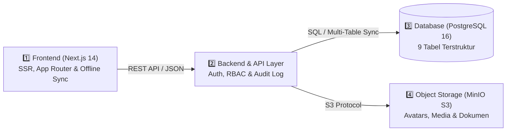
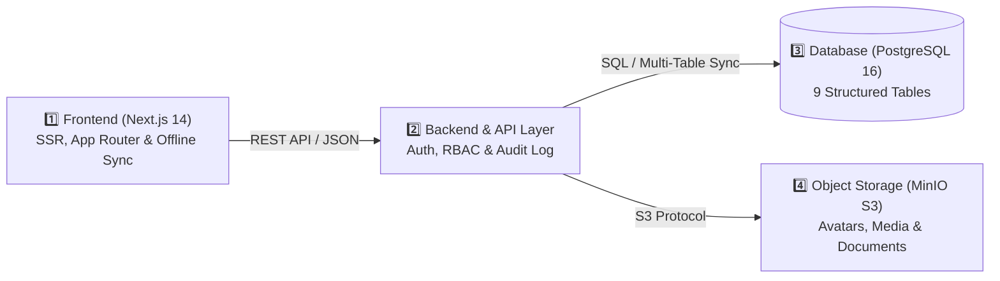

<div align="center">

# 🏛️ SISTEM INFORMASI BATALYON WIRA SATYA AKPOL 1996
### *Wira Satya 1996 Alumni Information System — Digital Directory, Tour of Duty, Social Feed, & Treasury Portal*

[](./README.id.md)
[](./README.en.md)

[](https://nextjs.org/)
[](https://www.typescriptlang.org/)
[](https://tailwindcss.com/)
[](https://www.docker.com/)
[](https://www.postgresql.org/)
[](https://min.io/)

<br/>

**[🇮🇩 Lompat ke Bahasa Indonesia](#-versi-bahasa-indonesia)** · **[🇬🇧 Jump to English Version](#-english-version)**  
**[🌐 Live Portal](https://wirasatya96.vercel.app)** · **[📖 Architecture (ID/EN)](./ARCHITECTURE.md)** · **[🛡️ Security Policy (ID/EN)](./SECURITY.md)** · **[🤝 Contributing (ID/EN)](./CONTRIBUTING.md)**

</div>

---

<a id="-versi-bahasa-indonesia"></a>

# 🇮🇩 VERSI BAHASA INDONESIA
*(Tersedia juga di berkas mandiri: [README.id.md](./README.id.md))*

> [!NOTE]
> **Batalyon Wira Satya 1996 — #SelaluBahagia**
> Platform informasi internal paguyuban perwira alumni Akademi Kepolisian 1996 (*Guyub, Peduli, & Mengabdi Sejak 1996*). Mengintegrasikan direktori penempatan tugas SOTK Polri (Mabes Polri, 38 Polda, Polres/Polrestabes/Metro, dan Penugasan Luar Struktur Kemen/Lembaga), pemetaan **28 fungsi kepolisian (*Tour of Duty*)**, linimasa silaturahmi leting, sistem **Buku Kas** (**Dana Sosial** & **Dana Investasi**) beserta kampanye **Penggalangan Dana (*Crowdfunding Milestone*)**, hingga pemetaan kesiapan purna tugas dan atensi kesehatan keluarga besar.

> [!IMPORTANT]
> **Kebijakan Privasi & Keamanan Data Publik (*Zero Data Leak*)**:
> Repositori ini dikonfigurasi aman untuk publik. Seluruh kredensial autentikasi, kunci enkripsi (`JWT_SECRET`), koneksi basis data produksi, serta data sensitif personel diisolasi menggunakan variabel lingkungan (`.env`) dan kebijakan kontrol akses berjenjang (*Role-Based Access Control*). Tidak ada kata sandi, kunci rahasia, atau data pribadi sensitif yang disertakan dalam kode sumber publik.

---

## 🏛️ Arsitektur Sistem (4-Tier Decoupled & Cloud-Synced)



- **Tier 1 — Presentation & Responsive UI**: Next.js 14 App Router dengan tema resmi *Bareskrim Crimson Red* (`#8B0000`) & *Gold Kehormatan* (`#D97706`), mendukung autentikasi multi-faktor (PIN & Biometrik FIDO2/WebAuthn) serta *Offline Sync Engine*.
- **Tier 2 — Application & Security API**: Layanan API terukur dengan validasi skema, otorisasi berbasis peran (*Multi-Role RBAC*), dukungan delegasi Ajudan (*ADC Mode*), dan pencatatan log audit otomatis.
- **Tier 3 — Relational Persistence**: PostgreSQL 16 (mendukung skema 9 tabel terpisah untuk sinkronisasi cloud multi-input tanpa konflik data).
- **Tier 4 — Object Storage**: MinIO S3 Server dengan pemisahan bucket publik dan privat (`wirasatya-avatars`, `wirasatya-posts`, `wirasatya-documents`).

---

## 🌟 Fitur-Fitur Utama Platform

| Modul | Ikon | Deskripsi & Fungsionalitas Utama | Pengguna Sasaran |
| :--- | :---: | :--- | :--- |
| **Beranda & Linimasa Silaturahmi** | 💬 | Feed publikasi giat leting dengan *infinite scroll*, 6 reaksi khas (*Siap, Mantap, Hormat, Peduli, Semangat, Terharu*), komentar bersarang, serta ringkasan cepat *Tour of Duty*, *Atensi Kesehatan*, dan *Dana Sosial & Investasi*. | Seluruh Alumni |
| **Jejaring & Buku Saku Digital** | 📖 | Direktori perwira alumni dengan filter wilayah (Mabes Polri, 38 Polda, Luar Struktur), pengurutan cerdas (`Aktif → Purna → PTDH → Almarhum`), serta kontak cepat WhatsApp Perwira & Ajudan (ADC). | Seluruh Alumni & Pengurus |
| **Jabatan & Tour of Duty** | 🎖️ | Pemetaan penugasan personel berdasarkan TR Kapolri dan **28 Fungsi Kepolisian**, dilengkapi pencarian riwayat jabatan dan pencatatan prestasi operasional/inovasi. | Seluruh Alumni & SDM |
| **Buku Kas (Dana Sosial & Investasi)** | 💰 | Transparansi perbendaharaan angkatan yang terbagi menjadi **Dana Sosial** (iuran wajib, sukarela, santunan sakit, dana duka) & **Dana Investasi** (deposito, obligasi/SBN, emas/logam mulia, unit usaha, properti), dilengkapi fitur **Penggalangan Dana (*Crowdfunding Milestone*)** yang dapat diedit oleh pengurus. | Bendahara, Pengurus & Alumni |
| **Anev Leting & Kesehatan** | 🩺 | Panel monitoring rekan atau keluarga yang membutuhkan pendampingan medis/rawat inap beserta koordinasi dukungan doa & bantuan sosial. | Bidang Kesejahteraan & Pimpinan |
| **Kesiapan Purna Tugas & Usaha** | 👔 | Pemetaan masa purna bhakti (BUP 58 tahun), sebaran domisili/hunian pasca-dinas, serta katalog unit usaha mandiri rekan leting. | Seluruh Alumni |
| **Manajemen Pengguna & Log Audit** | 🛡️ | Panel verifikasi pendaftar baru, pengelolaan akun berjenjang, delegasi akun Ajudan (ADC), fitur pemulihan akun terhapus (*Restore User*), serta rekam jejak audit (*Audit Log*). | Superadmin, Ketua & Sekretaris |

---

## 📱 Desain Responsif Adaptif (Desktop PC vs Smartphone HP)

- **Tampilan Desktop / PC (`lg:`)**:
  - Menampilkan tata letak 3 kolom utuh di Beranda (Kolom Kiri: *Profil Saya*, *Tour of Duty*, & kartu `#SELALUBAHAGIA`; Kolom Tengah: *Buat Postingan*, *Filter Linimasa*, & *Feed*; Kolom Kanan: *Atensi Kesehatan*, *Dana Sosial & Investasi*, & identitas *Batalyon Wira Satya 1996*).
  - Menampilkan teks tombol dan label informasi secara lengkap dan deskriptif.
- **Tampilan Smartphone / HP (`< lg`)**:
  - **Header Kartu Buka-Tutup (*Collapsible Cards*)**: Kartu ringkasan (*Profil Saya*, *Tour of Duty*, *Atensi Kesehatan*, *Dana Sosial & Investasi*) tampil ringkas hanya bagian *header* dan dapat diklik untuk membuka detail serta tombol navigasi menu.
  - **Infinite Scroll Feed Terjaga**: Daftar postingan di Beranda HP memiliki kontainer gulir mandiri sehingga saat digulir terus-menerus tidak menenggelamkan kartu `#SELALUBAHAGIA` dan identitas `BATALYON WIRA SATYA 1996` di bagian paling bawah.
  - **Efisiensi Kata & Tooltip `(i)`**: Label tombol diringkas khusus pada layar HP agar tidak turun baris, dilengkapi *tooltip* informasi ramah layar sentuh.

---

## 🚀 Panduan Memulai Cepat ( Bahasa Indonesia )

### Menggunakan Docker Compose:
```bash
git clone https://github.com/omeko42/wirasatya96.git
cd wirasatya96
cp .env.example .env
docker-compose up --build -d
```

### Mode Pengembangan Lokal (Standalone):
```bash
npm install
cp .env.example .env
npm run dev
```

### Matriks Hak Akses (Multi-Role RBAC):
| Peran (Role) | Lingkup Wewenang Utama |
| :--- | :--- |
| **SUPERADMIN** | Kendali penuh sistem, manajemen & pemulihan seluruh akun pengguna, serta pemeliharaan basis data. |
| **KETUA ANGKATAN** | Akses penuh *Executive Dashboard* (*Anev Leting*), pemantauan wilayah & kesehatan, serta pengelolaan pengguna di bawahnya. |
| **SEKRETARIS** | Verifikasi pendaftar baru, pemutakhiran direktori 38 Polda/Mabes, administrasi TR, dan pengelolaan akun anggota. |
| **BENDAHARA** | Pengelolaan penuh *Buku Kas* (**Dana Sosial** & **Dana Investasi**), kampanye **Penggalangan Dana**, dan verifikasi iuran. |
| **ANGGOTA & ADC** | Akses Buku Saku Digital, Linimasa, Obrolan, pembaruan profil mandiri/delegasi ADC tercatat, serta transparansi kas. |

---
---

<a id="-english-version"></a>

# 🇬🇧 ENGLISH VERSION
*(Also available as a standalone file: [README.en.md](./README.en.md))*

> [!NOTE]
> **Wira Satya Battalion 1996 — #SelaluBahagia**
> An internal community & executive portal for alumni officers of the 1996 Indonesian National Police Academy (*United, Caring, & Serving Since 1996*). It integrates nationwide organizational placement mapping (National Police Headquarters / Mabes Polri, 38 Regional Police Commands / Polda, Resort Commands, and External Ministry/Agency Assignments), **28 Police Functional Categories (*Tour of Duty*)**, an interactive alumni timeline, a transparent **Treasury Ledger** split into **Social Funds (*Dana Sosial*)** & **Investment Funds (*Dana Investasi*)** with editable **Crowdfunding / Milestone Campaigns**, healthcare attention tracking, and retirement readiness analytics.

> [!IMPORTANT]
> **Public Repository Security & Zero Data Leak Policy**:
> This repository is strictly sanitized for public visibility. All authentication credentials, cryptographic signing keys (`JWT_SECRET`), production database endpoints, and sensitive personnel records are isolated via environment variables (`.env`) and enforced by hierarchical Role-Based Access Control (RBAC). No plaintext passwords, private keys, or sensitive personal records are stored in the public source code.

---

## 🏛️ System Architecture (4-Tier Decoupled & Cloud-Synced)



- **Tier 1 — Presentation & Adaptive UI**: Next.js 14 App Router styled in the signature *Bareskrim Crimson Red* (`#8B0000`) & *Officer Gold* (`#D97706`) theme, supporting multi-factor authentication (Security PIN & FIDO2/WebAuthn Biometrics) and an *Offline Sync Engine*.
- **Tier 2 — Application & Security API**: Modular REST API enforcing schema validation, hierarchical Role-Based Access Control (RBAC), Aide-de-Camp (*ADC Delegation Mode*), and automated tamper-evident audit logging.
- **Tier 3 — Relational Persistence**: PostgreSQL 16 (featuring a 9-table structured schema for concurrent multi-user cloud synchronization without write contention).
- **Tier 4 — Object Storage**: MinIO S3-compatible storage segregating public media buckets from private document buckets (`wirasatya-avatars`, `wirasatya-posts`, `wirasatya-documents`).

---

## 🌟 Core Platform Modules

| Module | Icon | Key Features & Capabilities | Target Users |
| :--- | :---: | :--- | :--- |
| **Home & Alumni Timeline (Feed)** | 💬 | Interactive social feed with infinite scroll, 6 custom battalion reactions, nested comments, and quick-access summary cards for *Tour of Duty*, *Healthcare Attention*, and *Social & Investment Funds*. | All Alumni |
| **Network & Digital Pocketbook** | 📖 | Comprehensive alumni directory with regional filters (Mabes Polri, 38 Regional Commands/Polda, External Agencies), smart default sorting (`Active → Retired → PTDH → Deceased`), and one-click WhatsApp contact for officers & their Aide-de-Camp (ADC). | All Alumni & Board |
| **Positions & Tour of Duty** | 🎖️ | Career history and assignment tracking across **28 Police Functions**, complete with mutation order (TR) references and operational/innovation achievements. | All Alumni & HR |
| **Treasury Ledger (*Buku Kas*)** | 💰 | Dual-pillar financial transparency divided into **Social Funds (*Dana Sosial*)** (annual dues, voluntary contributions, medical assistance, bereavement funds) and **Investment Funds (*Dana Investasi*)** (time deposits, government bonds/SBN, gold bullion, business units, property), plus editable **Crowdfunding / Milestone Campaigns**. | Treasurer, Board & Alumni |
| **Battalion Analytics & Healthcare** | 🩺 | Real-time monitoring of colleagues or family members undergoing medical care/hospitalization, enabling coordinated support and prayers. | Welfare Division & Leadership |
| **Retirement Readiness & Ventures** | 👔 | Mandatory retirement age (58 years) projection, post-service residential mapping, and a directory of alumni-owned enterprises. | All Alumni |
| **User Management & Audit Log** | 🛡️ | New member verification queue, hierarchical user management, Aide-de-Camp (ADC) account delegation, soft-delete account recovery (*Restore User*), and comprehensive *Audit Logs*. | Superadmin, Chairman & Secretary |

---

## 📱 Adaptive Responsive Design (Desktop PC vs Mobile Smartphone)

- **Desktop / PC View (`lg:`)**:
  - Preserves the full 3-column executive layout on the Home page (Left Rail: *My Profile*, *Tour of Duty*, & `#SELALUBAHAGIA` card; Center Feed: *Post Composer*, *Timeline Filters*, & *Feed*; Right Rail: *Healthcare Attention*, *Social & Investment Funds*, & *Batalyon Wira Satya 1996* identity footer).
  - Displays complete, descriptive button and badge labels across all menus.
- **Mobile / Smartphone View (`< lg`)**:
  - **Collapsible Summary Card Headers**: Summary cards (*My Profile*, *Tour of Duty*, *Healthcare Attention*, *Social & Investment Funds*) render as compact single-line headers on mobile and expand smoothly when tapped to reveal details and navigation links.
  - **Self-Contained Infinite Scroll Feed**: On mobile devices, the Home feed scrolls within a dedicated container so continuous scrolling loads additional posts without pushing the `#SELALUBAHAGIA` card and the `BATALYON WIRA SATYA 1996` footer out of reach at the bottom.
  - **Concise Mobile Labels & `(i)` Tooltips**: Button labels automatically switch to concise single-line text on mobile screens (`sm:hidden`) paired with touch-friendly info tooltips to prevent layout wrapping.

---

## 🚀 Quick Start Guide ( English )

### Using Docker Compose:
```bash
git clone https://github.com/omeko42/wirasatya96.git
cd wirasatya96
cp .env.example .env
docker-compose up --build -d
```

### Standalone Local Development:
```bash
npm install
cp .env.example .env
npm run dev
```

### Role-Based Access Control (RBAC) Matrix:
| Role | Scope of Authority |
| :--- | :--- |
| **SUPERADMIN** | Full system configuration control, user account lifecycle management & restoration, and database maintenance. |
| **CHAIRMAN (*KETUA*)** | Full access to the *Executive Dashboard* (*Anev Leting*), regional & healthcare monitoring, and subordinate user management. |
| **SECRETARY (*SEKRETARIS*)** | Verification of new member registrations, directory updates across 38 Polda/Mabes, TR administration, and member account management. |
| **TREASURER (*BENDAHARA*)** | Full management of the *Treasury Ledger* (**Social Funds** & **Investment Funds**), **Crowdfunding Campaigns**, and dues verification. |
| **MEMBER & ADC (*ANGGOTA*)** | Access to the Digital Directory, Timeline, Messaging, self-service or audited ADC-delegated profile updates, and treasury transparency. |

---

## 📁 Repository Directory Structure / Struktur Direktori

```text
wirasatya96/
├── backend/                       # [Tier 2] Express REST API & TypeScript Service
├── database/                      # [Tier 3] Relational Database Schemas (PostgreSQL / Cloud Sync)
├── minio/                         # [Tier 4] MinIO S3 Bucket Initialization Scripts
├── src/                           # [Tier 1] Next.js 14 Web Application (App Router)
│   ├── app/                       # Pages, Layouts, & API Route Handlers
│   ├── components/                # Responsive UI Components (PC & Mobile Optimized)
│   ├── data/                      # SOTK Polri Reference & 28 Police Functions
│   ├── lib/                       # Cloud Sync Engine, Offline Cache, & Server Store
│   └── types/                     # Centralized TypeScript Interfaces
├── .env.example                   # Public-Safe Environment Variables Template
├── docker-compose.yml             # 4-Tier Container Orchestration
├── README.md                      # Bilingual Main Documentation (ID & EN)
├── README.id.md                   # Complete Documentation in Bahasa Indonesia
├── README.en.md                   # Complete Documentation in English
├── ARCHITECTURE.md                # Technical Architecture Specification (ID & EN)
├── SECURITY.md                    # Security & Data Privacy Policy (ID & EN)
└── CONTRIBUTING.md                # Developer Contribution Guidelines (ID & EN)
```

<div align="center">
  <sub>Batalyon Wira Satya Akpol 1996 • <i>Guyub, Peduli, & Mengabdi Sejak 1996 — #SelaluBahagia</i></sub>
</div>
