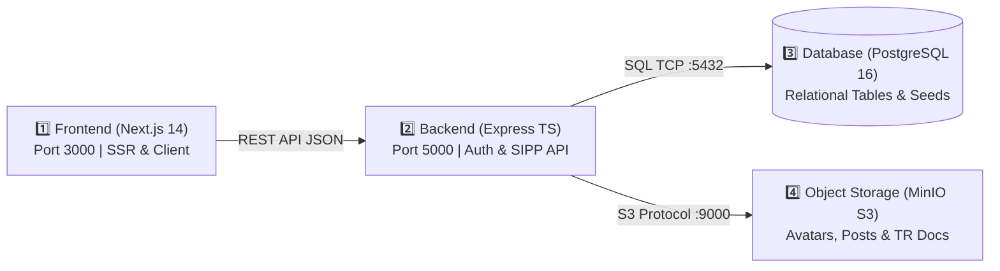

<div align="center">

# 🏛️ SISTEM INFORMASI BATALYON WIRA SATYA AKPOL 1996
### Platform Terpadu Buku Saku Digital, Linimasa Silaturahmi, & Sistem Kesejahteraan Alumni Akpol 1996

[](https://nextjs.org/)
[](https://www.typescriptlang.org/)
[](https://tailwindcss.com/)
[](https://www.docker.com/)
[](https://www.postgresql.org/)
[](https://min.io/)
[](#-identitas-visual--desain-sistem)

<br/>

**[🌐 Buka Live Production Portal (Vercel)](https://wirasatya96.vercel.app)** · **[📖 Baca Spesifikasi Arsitektur](./ARCHITECTURE.md)** · **[🛡️ Kebijakan Keamanan](./SECURITY.md)** · **[🤝 Panduan Kontribusi](./CONTRIBUTING.md)**

</div>

---

> [!NOTE]
> **Batalyon Wira Satya 1996 — #SelaluBahagia**
> Aplikasi internal paguyuban perwira alumni Akademi Kepolisian 1996. Mengintegrasikan direktori penempatan tugas SIPP Polri (Mabes Polri, 38 Polda, Polres/Polrestabes/Metro, dan Penugasan Luar Struktur Kemen/Lembaga), linimasa silaturahmi leting dengan multi-reaksi, pelaporan mutasi jabatan (TR), transparansi perbendaharaan kas, serta pemetaan kesiapan purna tugas dan atensi kesehatan khusus keluarga besar leting 1996.

---

## 📑 Daftar Isi (Table of Contents)

1. [Ringkasan Eksekutif & Arsitektur 4-Tier](#-ringkasan-eksekutif--arsitektur-4-tier)
2. [Fitur-Fitur Utama Platform](#-fitur-fitur-utama-platform)
3. [Identitas Visual & Desain Sistem](#-identitas-visual--desain-sistem)
4. [Struktur Organisasi & Tata Kerja (SOTK) Polri](#-struktur-organisasi--tata-kerja-sotk-polri)
5. [Struktur Direktori Repositori](#-struktur-direktori-repositori)
6. [Panduan Memulai Cepat (Getting Started via Docker)](#-panduan-memulai-cepat-getting-started-via-docker)
7. [Menjalankan Proyek Secara Standalone (Development Mode)](#-menjalankan-proyek-secara-standalone-development-mode)
8. [Variabel Lingkungan (Environment Variables)](#-variabel-lingkungan-environment-variables)
9. [Hak Akses Berbasis Peran (Multi-Role RBAC)](#-hak-akses-berbasis-peran-multi-role-rbac)
10. [Lisensi & Kebijakan Keamanan](#-lisensi--kebijakan-keamanan)

---

## 🏛️ Ringkasan Eksekutif & Arsitektur 4-Tier

Sistem dibangun menggunakan paradigma **4-Tier Decoupled Architecture** untuk performa tinggi, keandalan maksimal, dan kemudahan deployment:



- **Tier 1 (Presentation)**: Next.js 14 App Router dengan antarmuka profesional bernuansa *Bareskrim Crimson Red*, responsif di desktop maupun smartphone, mendukung autentikasi biometrik FIDO2 (Touch ID / Face ID / Windows Hello).
- **Tier 2 (Application API)**: Express.js & TypeScript microservice dengan validasi skema ketat, otorisasi berbasis peran (RBAC), dan generator MinIO presigned URL.
- **Tier 3 (Data Persistence)**: PostgreSQL 16 Alpine dengan integritas relasional, skema tabel terindeks, dan audit pencatatan otomatis.
- **Tier 4 (Object Storage)**: MinIO S3 Server berkecepatan tinggi dengan 3 bucket terpisah (`wirasatya-avatars`, `wirasatya-posts`, `wirasatya-documents`).

*Untuk diagram data flow lengkap dan rincian jaringan antar kontainer, silakan pelajari [ARCHITECTURE.md](./ARCHITECTURE.md).*

---

## 🌟 Fitur-Fitur Utama Platform

| Modul | Ikon | Deskripsi & Fungsionalitas | Pengguna Sasaran |
|---|:---:|---|---|
| **Buku Saku Digital** | 📖 | Direktori perwira alumni Akpol 1996 lengkap dengan filter penempatan wilayah (38 Polda, Mabes Polri, Polres, Kemen/Lembaga), pencarian cepat nama/NRP, serta tombol *One-Click WhatsApp* ke perwira dan Ajudan (ADC). | Seluruh Alumni & Pengurus |
| **Linimasa Silaturahmi (Feed)** | 💬 | Feed publikasi kegiatan leting bergaya LinkedIn dengan dukungan 6 multi-reaksi khas kepolisian (Siap, Mantap, Hormat, Peduli, Semangat, Terharu), komentar bersarang, dan unggah foto media. | Seluruh Alumni |
| **Riwayat Jabatan & TR** | 🎖️ | Rekapitulasi mutasi dan promosi jabatan leting berdasarkan Surat Telegram (TR) Kapolri, pencarian riwayat satker, dan pengelompokan fungsi (Reserse, Intelkam, Lantas, Binmas, Samapta, Brimob). | Seluruh Alumni & SDM |
| **Anev Leting & Kesehatan** | 🩺 | Panel monitoring atensi rekan atau keluarga yang membutuhkan pendampingan medis, pemetaan penyakit kronis, dan monitoring fasilitas rujukan RS Bhayangkara. | Bidang Kesejahteraan & Pimpinan |
| **Bendahara Portal** | 💰 | Sistem transparansi kas paguyuban: total saldo kas, grafik pemasukan & pengeluaran, rekapitulasi iuran sukarela leting, dan unduh laporan perbendaharaan transparan. | Bendahara & Seluruh Alumni |
| **Kesiapan Purna Tugas** | 👔 | Analisis tahun pensiun, kalkulasi sisa tahun dinas perwira leting, direktori unit usaha/bisnis mandiri rekan leting, dan fasilitas sinergi ekonomi pasca dinas aktif. | Pamen/Pati & Bhayangkara Purna |
| **Executive Dashboard** | 📊 | Dashboard analitik komprehensif bagi pimpinan dan sekretariat: rasio sebaran penugasan perwira di seluruh Indonesia, visualisasi demografi, dan rekapitulasi data belum terisi. | Ketua, Sekretariat & Superadmin |

---

## 🎨 Identitas Visual & Desain Sistem

Platform ini menerapkan tema resmi **Bareskrim Crimson Red**:
- **Warna Utama**: Deep Crimson Red (`#8B0000` / `#991B1B`), dipadukan dengan aksen Emas Kehormatan Perwira Polri (`#D97706`).
- **Logo Resmi WS 1996**: Desain *squircle* 3D dengan gradasi merah elegan, teks **"WS"** menggunakan tipografi tegas **Arial Black**, dan **"1996"** menggunakan font geometris modern **Bierstadt** (fallback: *Aptos*).
- **Favicon & Web App Icon**: Terintegrasi otomatis dalam format SVG vektor beresolusi tinggi di [src/app/icon.svg](file:///d:/Project/KAP%20IDAH/wirasatya96/src/app/icon.svg).
- **Desain Bersih**: Menghilangkan warna biru generik media sosial dan menggantinya dengan sentuhan wibawa korps kepolisian Indonesia.

---

## 👮 Struktur Organisasi & Tata Kerja (SOTK) Polri

Sistem informasi ini mengadopsi struktur SOTK Polri resmi terkini:
1. **MABES POLRI**: Mencakup Bareskrim (seluruh Dittipid dan Puslabfor/Inafis/Iknas), Baintelkam, Baharkam, Korbrimob, Korlantas, **Kortastipidkor** (*Korps Baru Pemberantasan Korupsi 2024*), Densus 88 AT, Lemdiklat Polri (Sespim, Akpol, STIK), Pusdokkes, Itwasum, Astamaops, Astamarena, SSDM, Slog, Divpropam, Divhumas, Divhubinter, Divkum, dan DivTIK.
2. **POLDA (38 Wilayah Hukum)**: 34 Polda eksisting ditambah 4 Polda baru di wilayah Papua (Polda Papua Tengah, Papua Selatan, Papua Barat Daya, Papua Pegunungan) dengan struktur Direktorat, Biro, dan Bidang lengkap.
3. **POLRES / POLRESTABES / POLRES METRO**: Satuan kewilayahan untuk jabatan Kapolres, Wakapolres, dan PJU Polres.
4. **KEMENTERIAN / LEMBAGA (Penugasan Luar Struktur)**: BIN, BNN, BNPT, Lemhannas RI, KPK, BSSN, Kemenko Polkam, Kemensetneg/Setmilpres, Bakamla, dan kementerian terkait.
5. **PURNA TUGAS**: Klasifikasi kehormatan untuk rekan purnawirawan dan masa persiapan pensiun (MPP).

> [!TIP]
> **Catatan Relevansi**: Seluruh letting Akpol 1996 saat ini berpangkat **Kombes Pol**, **Brigjen Pol**, atau **Irjen Pol**. Oleh karena itu, satuan kerja tingkat **Polsek telah dieliminasi total** dari formulir pendataan dan antarmuka filter demi menjaga relevansi serta efisiensi input data.

---

## 📁 Struktur Direktori Repositori

```
wirasatya96/
├── backend/                       # [Tier 2] Dedicated Express REST API & TypeScript
│   ├── src/
│   │   ├── config/                # Database Pool & MinIO Client Config
│   │   ├── routes/                # Modular REST Endpoints (Auth, Members, Posts, Kas)
│   │   └── index.ts               # Express Entrypoint & Server Setup
│   ├── backend.Dockerfile         # Container Dockerfile Backend
│   └── package.json
├── database/                      # [Tier 3] Database Scripts & Initialization
│   └── init.sql                   # Skema DDL Relasional, Indeks & Data Awal
├── minio/                         # [Tier 4] Object Storage Configuration
│   ├── init-buckets.sh            # Inisialisasi Otomatis Bucket & Kebijakan ACL (Docker)
│   └── setup-buckets.bat          # Skrip Inisialisasi Lokal (Windows)
├── src/                           # [Tier 1] Next.js 14 Frontend Web Portal
│   ├── app/                       # Next.js App Router (Layout, Page, Icon SVG, Login)
│   ├── components/                # Komponen UI (WSLogo, Navbar, FormWizard, Feed, Kas)
│   ├── data/                      # SOTK Polri, Daftar Polda, Mock Data & Typings
│   └── types/                     # TypeScript Interfaces (AnggotaWiraSatya, SIPP Models)
├── docker-compose.yml             # Orkestrasi 4 Layanan Sekaligus
├── frontend.Dockerfile            # Container Dockerfile Frontend
├── ARCHITECTURE.md                # Dokumentasi Spesifikasi Arsitektur Lengkap
├── CONTRIBUTING.md                # Panduan Kontribusi & Konvensi Commit
├── SECURITY.md                    # Kebijakan Keamanan & Prosedur Pelaporan Celah
└── README.md                      # Dokumentasi Utama Repositori
```

---

## 🚀 Panduan Memulai Cepat (Getting Started via Docker)

Cara tercepat untuk menjalankan seluruh sistem (Frontend, Backend, Database, MinIO) adalah menggunakan **Docker Compose**:

### Prasyarat:
- [Docker Desktop](https://www.docker.com/products/docker-desktop/) (v20+ dengan Docker Compose v2+) telah terpasang dan aktif di komputer Anda.

### 1. Kloning Repositori:
```bash
git clone https://github.com/omeko11/wirasatya96.git
cd wirasatya96
```

### 2. Jalankan Seluruh Kontainer:
```bash
docker-compose up --build -d
```

### 3. Akses Layanan Melalui Browser:
- **Frontend Portal**: [http://localhost:3000](http://localhost:3000)
- **Backend REST API Healthcheck**: [http://localhost:5000/api/health](http://localhost:5000/api/health)
- **MinIO Object Storage Console**: [http://localhost:9001](http://localhost:9001)  
  *(User: `minioadmin`, Password: `minioadmin_ws96_secure`)*
- **PostgreSQL Database Port**: `localhost:5432`

### 4. Menghentikan Kontainer:
```bash
docker-compose down
```

---

## 💻 Menjalankan Proyek Secara Standalone (Development Mode)

Jika ingin menjalankan kode secara lokal untuk kebutuhan debugging atau pengembangan cepat:

### 1. Frontend (Next.js 14):
```bash
# Pastikan berada di root direktori
npm install
npm run dev

# Aplikasi akan berjalan di http://localhost:3000
```

### 2. Backend (Express API):
```bash
cd backend
npm install
npm run dev

# API server akan berjalan di http://localhost:5000
```

### 3. Pengujian Build Produksi:
```bash
npm run build
```

---

## ⚙️ Variabel Lingkungan (Environment Variables)

Contoh konfigurasi variabel lingkungan yang digunakan oleh backend dan frontend:

```env
# Frontend Configuration
NEXT_PUBLIC_API_URL=http://localhost:5000/api

# Backend Server Configuration
PORT=5000
NODE_ENV=production
JWT_SECRET=wirasatya96_super_secret_jwt_key_polri_2026

# Database Connection (PostgreSQL)
DB_HOST=localhost
DB_PORT=5432
DB_USER=postgres
DB_PASSWORD=postgres_ws96_secure
DB_NAME=wirasatya96

# MinIO Object Storage Connection
MINIO_ENDPOINT=http://localhost:9000
MINIO_REGION=us-east-1
MINIO_ACCESS_KEY=minioadmin
MINIO_SECRET_KEY=minioadmin_ws96_secure
BUCKET_AVATARS=wirasatya-avatars
BUCKET_POSTS=wirasatya-posts
BUCKET_DOCUMENTS=wirasatya-documents
```

---

## 👥 Hak Akses Berbasis Peran (Multi-Role RBAC)

Platform dilengkapi sistem *Role Switcher* instan untuk pengujian fungsionalitas berdasarkan wewenang:

| Role | Identitas Akun Demo | Wewenang Khusus |
|---|---|---|
| **SUPERADMIN** | `omeko11` (NRP 74010001) | Akses kontrol penuh: manajemen user, audit log sistem, konfigurasi SIPP, ekspor data global. |
| **KETUA** | Irjen Pol. Suwondo Nainggolan | Executive Dashboard, pemantauan menyeluruh kesejahteraan dan mutasi leting, persetujuan program. |
| **SEKRETARIAT** | Kombes Pol. Yulius Bambang | Pengelolaan direktori anggota, pembaruan data penempatan 38 Polda, verifikasi profil perwira. |
| **BENDAHARA** | Kombes Pol. Heru Susanto | Akses penuh modul Bendahara Portal, pencatatan transaksi masuk/keluar kas, rekapitulasi iuran. |
| **ANGGOTA** | Kombes Pol. Hadi Wicaksono | Partisipasi Feed linimasa, Buku Saku digital, pembaruan data mandiri, donasi iuran, info purna tugas. |

---

## 📄 Lisensi & Kebijakan Keamanan

- **Hak Cipta**: © 2026 Paguyuban Alumni Akademi Kepolisian 1996 — Batalyon Wira Satya. Seluruh hak cipta dilindungi undang-undang.
- **Kebijakan Keamanan**: Silakan membaca [SECURITY.md](./SECURITY.md) untuk rincian isolasi data dan pelaporan celah keamanan secara tertutup.
- **Kontribusi Pengembang**: Silakan membaca [CONTRIBUTING.md](./CONTRIBUTING.md) sebelum mengajukan *Pull Request*.

<div align="center">
  <sub>Batalyon Wira Satya Akpol 1996 • <i>#SelaluBahagia</i></sub>
</div>
